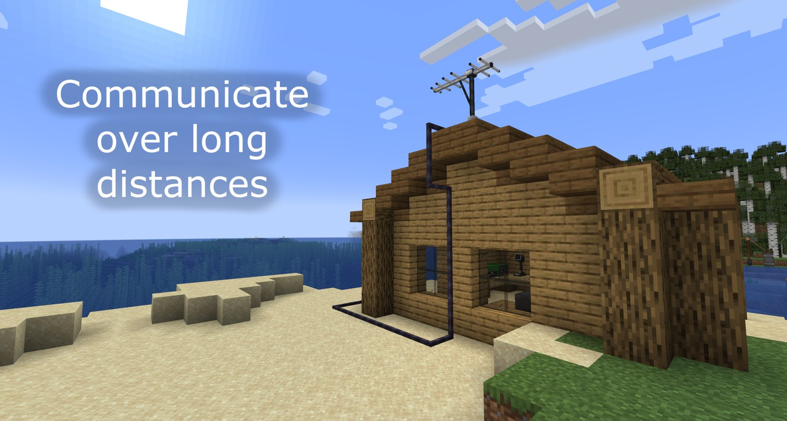
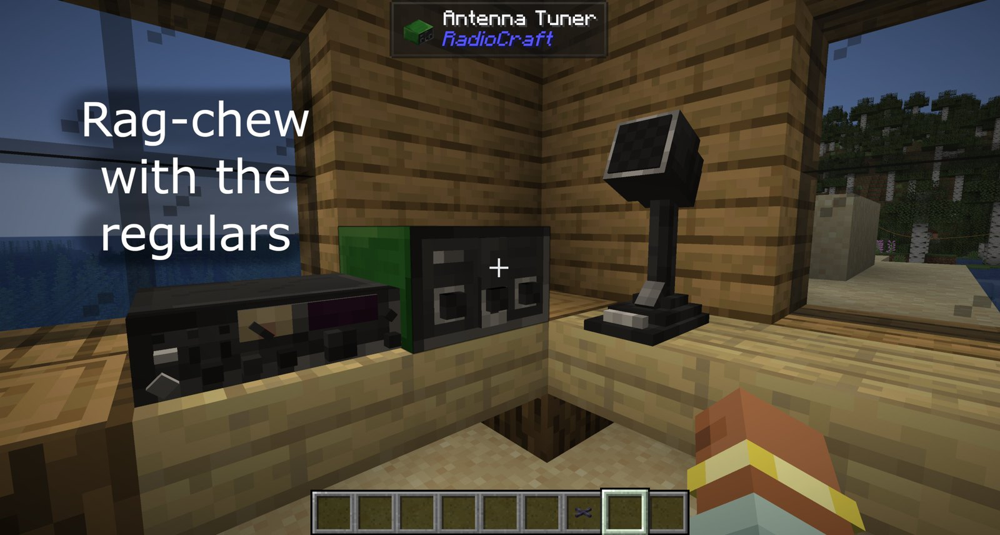
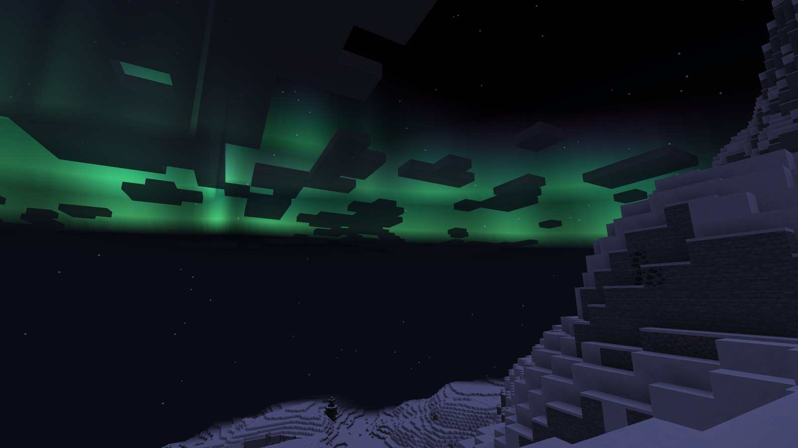

# Radio Craft (Amateur Radio Mod for Minecraft)
Minecraft Mod that brings functioning Ham Radios into the game - Funded by the ARRL

Download on Modrinth here: https://modrinth.com/mod/radiocraft

### [Click here for setup instructions](https://github.com/hammcmod/RadioCraft/wiki/Setting-up-Radiocraft)

Join our Discord here: https://discord.gg/tZFWE2jYQX

View details about the project, and read the wiki: [https://radiocraft.bigtimeradio.us](https://radiocraft.bigtimeradio.us/)

## What it does

- HF transceivers (80m, 40m, 20m, 10m), QRP and all-band rigs, VHF base stations, handhelds and a manpack, talking
  over Simple Voice Chat with CW and RTTY alongside voice
- Wire antennas you string yourself (dipoles, inverted V, OCFD, delta loop, Moxon, random wire) and built ones
  (verticals, J-pole, Slim Jim, Ringo, Yagi), with SWR, tuners, baluns and coax that all matter
- Propagation that follows the band, the time of day, the terrain and the solar weather: skip zones, blackouts,
  sporadic E and aurorae
- Solar and battery power, repeaters with duplexers and CTCSS, APRS terminals with maps, a teletype, a radio fax,
  microwave links and direction finding
- Radio sites that generate in the world, some with commercial stations already on the air
- Weather reports and WEFAX charts, with live storms when [Another Weather Mod](https://github.com/ITCMD/AnotherWeatherMod)
  is installed

The in-game guide book (given on first join, or `/radio guide`) covers every block and how to build each station.

# Development Goals

Please check [here](https://docs.google.com/document/d/e/2PACX-1vQd1fckIrMKPCIMzikjnUJXj8BcSUgornQIC97nqVmv2SQJ25S-z2kYKaAMlZRcO88ntJBxjRx0q2nM/pub) for information about the objectives of the project. Other contributions are welcome, but these are the goals of the project.

See [AGENTS.md](AGENTS.md) for how the repository is laid out, how to build and run it, and how it is tested.
