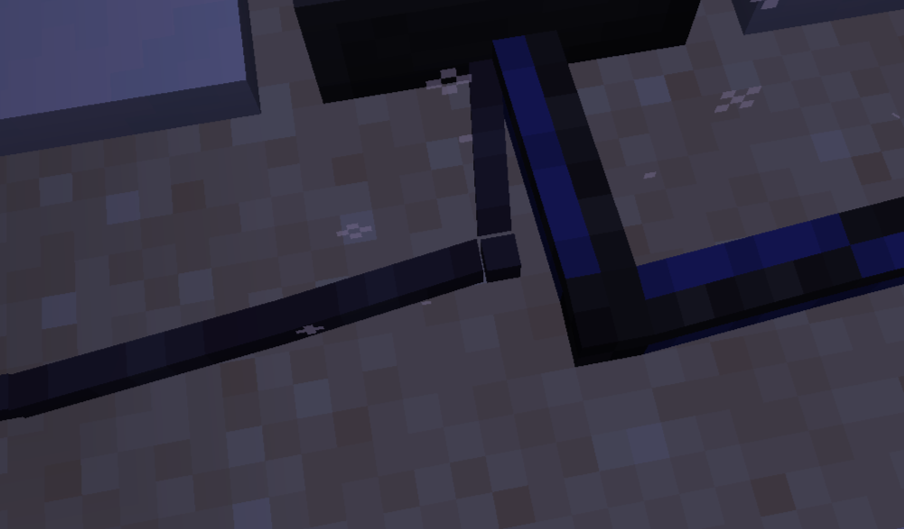

# Needs Testing

Things that are implemented and pass the automated tests but still need a human at a client (rendering, GUI, audio,
feel). Add to this list whenever a change cannot be fully verified by `test` / `runGameTestServer`.

Work through it with `python tools/needs_testing.py` (a local page: pass, needs work, comments, screenshots), which
writes back here: `- [ ]` not tested, `- [x]` passed, `- [!]` needs work, with `Note (date): ...` comments and
`` screenshots indented under the item. Whoever picks up a `[!]` item fixes it (or moves
it to [todo.md](../todo.md)), then sets it back to `[ ]` for the next playtest.

## Radio sites and modules on the air (added 2026-10-28, evening)

Six sites generate in normal worlds (`radio_sites`), placed unturned; `SiteGameTests` checks every station in each
works as found. A commercial radio module is sent from `CommercialStations` whether its chunk is loaded or not, and
one at a site nobody has found yet is on the air once a player is within `commercial_station_range` (6000) of it.

- [ ] In a new normal world, `/locate structure radiocraft:repeater_site` (and the others): each site sits on its
  ground, not floating or buried (the buried bunker excepted), with the terrain blended round it; Long Lines and the
  repeater site only on high ground (y 130 and up).
- [ ] Copies of Long Lines have 1 to 4 horns, each still with its microwave radio inside; no stray horn parts.
- [ ] Some observatories and DF stations have a commercial radio module (a third of them); the bunker never does.
- [ ] Before going to a site with a module, tune to it from far off (`/rcdebug stations` lists the nearest, predicted ones
  marked): its program is heard, and is the same one the module plays once found.
- [ ] Fly away from a module until its chunk unloads: it is still heard (HF skip, or 2m within range).
- [ ] No lag spike while flying fast over new ground (the sites ahead are worked out off the server thread).
- [ ] Wires and bundles still look lit right (no dark patches under or beside cables, outdoors and in caves): skylight
  now passes them without asking their shape, which fixed a hang when a site with wires generated.

## Tower beam bends without flicker (added 2026-10-28)

Reported: where beams bend, the overlapping parts' textures glitch (z-fighting). The diagonal arms now sit 0.01 px
apart in layers (`tools/tower_beam_models.py`, `LAYER`): edge arms grow 0.01-0.04 px, corner arms 0.01-0.08 px.

- [ ] Thin, normal and thick beams: an L bend (east + north), a diagonal off a straight run (east + north_east), two
  diagonals from one block (north_east + north_west), an up-and-over bend (up + up_east) and a corner diagonal: no
  flickering stripes where the parts cross, from near and from a few blocks back.
- [ ] The diagonal arms do not look visibly fatter than the straight ones.

## Wire Junction (added 2026-10-28)

- [ ] A half-height galvanised steel box (creative tab, next to the duplexer): red wire into one side and blue out
  another power a radio from a battery as one circuit; any colour, any side, up and down too.
- [ ] Wire meets its sides with no gap; coax laid beside it does not connect.
- [ ] Looks right: lid rim and corner screws on top, seam and knockout on the sides.

## Bundles round bends, up lattice legs, power through a bundle (added 2026-10-28, afternoon)

Checked on a copy of the Structure Design world with the new `/rcdebug wires <from> <to>` (98 problems before, 9
after: all where a strand joins or leaves across others, now 0.01 px apart so they cross without flicker).

- [ ] A bundle laid round bends of both hands (north then east, north then west, and the rest): the strands keep their
  order round every bend, no crossing over.
- [ ] Strands peeling off one by one to a row of radios leave from the near side, without crossing the others.
- [ ] A bundle up the side of a lattice tower leg (beam, gap, beam): one straight line against the steel, no zigzag,
  no gaps between blocks; where the beams end it eases back to the block edge over one block.
- [ ] Where a strand has to cross others (it joins from the far side), it crosses without flickering.
- [ ] Microwave radios on a run of wire bundled with coax to their dishes power on (they were stuck on the coax only).
- [ ] Your existing bundles look right after loading (their turns are worked out when the chunk loads).
- [ ] Strands climbing a wall onto the floor above (the hole at the top of the tower) arrive in the same order they
  went up, no crossing at the lip. (Fixed later the same day: climbs now count in the turns.)
- [ ] A cable coming in from the side to a bundle running up an edge (the black coax halfway up the tower) meets that
  strand's run straight on, no slanting stub.
- [ ] (Later fix) The black coax halfway up the tower: the bundle's black strand turns onto the beam top and meets the
  wire lying there, no piece up at the top of the block. A bundle that was hanging from the ceiling there settles to the
  floor by itself when the chunk loads.
- [ ] Orange coming up through the hole at the top of the tower runs straight up and over, not slanting across.
- [ ] Down the radio row the strands peel off to their radios without crossing: a run now picks its own colour order
  (green first there). Bundles may show their colours in a different order from before; that is expected.
- [ ] The Jade tooltip on coax into a horn's other base blocks lists the horn (it showed "Connected Antennas: 0").
- [ ] Microwave radios wired from one battery of a bank turn on and draw on the whole bank: a battery's sides are now
  one circuit, so every wire touching it joins (before, the radios only had the one battery they touched, and it was flat).
- [ ] A charge controller now passes up to 180 FE a tick (20 panels in full sun; was 45). Several controllers set
  against one array split its power; the panels' tooltip still shows what the whole row makes.
- [ ] Holding a foothold, click the front of a foothold with open air behind it: the new one goes on top of the stack,
  in line with the beam, and again on the next click. Clicking a foothold's side still places one beside it on a wall.

## Microwave sites, beacon controller, horn feed and turning, stacked footholds (added 2026-10-28, late morning)

Needs a client restart and `./gradlew runData` (the beacon controller's name, loot and pickaxe tag).

- [ ] Three sites in a row (A, B, C), B with two microwave radios touching or on one power wire, one linked to A and
  one to C: a phone at A rings a phone at C, an H19 at A's beacon shows on C's H19, a fax goes A to C, and a direction
  finder at C gets A's bearing. `microwave_max_hops` set to 1 stops it.
- [ ] Tower Beacon Controller (creative tab, no recipe): looks like a thin beam, joins beams, and a redstone lamp or
  dust beside it blinks 2 s on, 2 s off; several controllers blink together.
- [ ] Coax laid against the outside of any of the horn's four base blocks connects (the radio finds the horn) and is
  drawn running across that base block's floor to the middle where the four meet; coax beside the horn higher up does
  not connect.
- [ ] Turning a horn left or right on the radio's ALIGN page turns the whole horn about the middle of its base; up and
  down stop at +/-45 degrees and do not tilt it. Its hitboxes stay where it was placed. It stays drawn when the block
  it was placed from is off screen, and breaking any part still takes it down.
- [ ] A foothold placed on top of another stays up with nothing behind it, in line with the one below (against a beam
  too); breaking the bottom one brings the ones standing on it down.
- [ ] No flicker on a beam just under a foothold's bottom rung (the rail now stops 0.01 px short of the steel).
- [ ] A redstone torch (or lamp, lantern) on top of a beam or the beacon controller: the beam reaches up into it, no gap.
- [ ] Back away from a horn: it stays drawn out to 256 blocks (or your render distance), not popping out at 64.
- [ ] Tower Beacon (shapeless: redstone torch, any tower beam, redstone lamp): a thin red light like a 300 mm TWR beacon. On a Tower Beacon Controller it blinks
  2 s on, 2 s off, glass glowing full bright at night, lighting the area (light 11); dark with no signal; the beam
  below reaches up into it. Looks right next to the thin beam (same width)?

## Tower beams: ground, walls, braces, footholds and coax (added 2026-10-28)

Needs a client restart (Java changes) and `./gradlew runData` first (the foothold's new `mount` blockstate).

- [ ] A beam on the ground reaches down to it (no gap under the core); one against a wall or under a ceiling reaches
  out to it, as iron bars do; a beam on its own in the air is still a straight post.
- [ ] A beam reaches up into an antenna, balun or pole mounted on top of it, and down into one hung under it.
- [ ] A diagonal brace is not drawn when any block (a wall, a fence, a wire, a foothold, a torch) stands beside the edge
  or corner it would run through; another beam there is fine.
- [ ] Footholds can be placed on the side of a beam (all three thicknesses), sit right against the steel, climb like
  a ladder there, and the outline matches; breaking the beam drops the foothold; on a full block they are as before.
- [ ] Coax (and power wire, and a bundle) laid up the side of a beam column hugs it, drawn against the steel, not at
  the block edge; the stub from the floor run to it reaches the run with no gap.
- [ ] At the top it climbs over the beam's top onto an antenna or balun standing on it (the radio finds the antenna).
- [ ] A run that carries on up past the top of the beams eases back to the block edge over one block, no step.
- [ ] Clicking the cable on a beam still selects it (its hitbox stays at the block edge, inside its own block).

## Radios on Sable ships (added 2026-10-28; GameTests pass without Sable)

Run `./gradlew runClient -PwithSable` (Sable 2.0.6 with Veil and its Rapier physics; add `-PwithCreate` for Create).
Build a small station on a platform (HF radio, battery, coax, a dipole on two antenna poles, a speaker), then make it
a ship with `/sable assemble area <from> <to>`. Another station stays on the ground for the far end.
`/rcdebug sable <pos>` on a ship block says where it really is. Checked on the dev server (2026-10-28): assembly
carries a wire strung between two poles, it survives aboard, and `/rcdebug sable` follows the ship through a teleport
and a 90 degree turn.

- [ ] The game loads with Sable, and with it absent (Sable Companion is bundled in our jar either way).
- [ ] After assembling, the station still works: power, coax, the radio hears the ground station and is heard.
- [ ] The dipole's antenna wires came along with the ship (both poles aboard) and still count as the antenna.
- [ ] Move or fly the ship away: signal strength follows the ship's real distance (not the far-away plot); past line
  of sight it goes to skip as on the ground.
- [ ] The radio's speaker audio comes from the ship as it moves, and a player talking next to the radio's mic on the
  ship still keys it.
- [ ] Radio, fax, tape player, telephone and microwave screens stay open while standing on the moving ship.
- [ ] A Yagi (or Moxon) on the ship: turn the ship and the far station's signal changes as the beam turns away.
- [ ] A direction finder on the ground points at the ship; one on the ship points at the ground station.
- [ ] An H19's APRS beacon from the ship shows the ship's real position on the ground station's map.
- [ ] A WEFAX receiver or weather station on the ship reports the weather where the ship is.
- [ ] A microwave dish on the ship: aimed at a ground dish it links, and turning the ship breaks the link.
- [ ] Sable's mass: batteries and tower footholds weigh the ship down, wires and poles hardly at all.

Reported 2026-10-27: two radios on 6275 MHz, dishes at AZ 179.8 / 359.0, both "NONE IN VIEW" with no RSSI. The meter
only listened for a radio of the other role (one end had to be Broadcast Master first) and said nothing about it.

- [x] Two powered radios on one frequency, neither made master: the ALIGN page already shows the far end's signal and,
  once it decodes, its callsign, so the dishes can be peaked before choosing a master.
- [x] The screens only say what the meter knows (maintainer, 2026-10-27 evening): `NO SIGNAL`, `TOO WEAK` (shows but
  will not link), `POOR`, `FAIR`, `GOOD`, on the ALIGN page and the STATUS page's RSSI line; a failed search or lost
  link says `NO SIGNAL: CHECK DISHES` or `SIGNAL TOO WEAK: ALIGN`. The why (no radio on the frequency, out of range,
  not facing, path blocked, each dish pair's distance and off-axis angles) is `/rcdebug microwave <pos>`.
- [ ] A dish just out of range, aimed right, still shows on the align graph as a weak signal (`TOO WEAK`) and fades
  out by a quarter past the range (`microwave_dish_range` 1500 by default; set it to 20 to try: at 20 blocks -70 dBm,
  22 still decodes (POOR), 23 too weak, 25 gone). Walking a pair apart, the grade goes GOOD, FAIR, POOR, TOO WEAK, NO SIGNAL.
- [x] The dish model now turns to where the maths points it: a dish set to AZ 0 looks north, 90 east, 180 south, 270
  west (it was drawn 180 off, so a pair "pointing at each other" by eye read NOT FACING). Two dishes aimed at each
  other by eye now show a signal. The horn is a plain block model and was not affected.
- [ ] The path is now checked block by block (`MicrowavePaths`), not on the HF terrain atlas, which blocked your two
  dishes over a one-block step: the yard layout (dishes on two-block poles, a dozen blocks apart over stepped snow)
  links. A tree trunk or leaves in the beam, or a wall, still blocks it (the beam leaves each dish from 0.75 blocks
  above its block; the four blocks nearest each dish never count).

## J-pole with coax beside it (added 2026-10-27, evening)

Reported 2026-10-27: a J-pole lost its texture transparency (the mount drew as a solid pink block) once coax was laid
beside it. The coax run-in model (`antenna_coax`) and the J-pole's upper half had no render type, so the multipart
mixed solid and cutout parts; both are cutout now, like the lower half.

- [x] A J-pole with and without coax beside it looks the same: see-through where the texture is, on all four facings.
  The Ionosonde and the 5-BTV with coax beside their base too (they share the run-in model).

## Thin wire, coloured wire, spaced bundles (added 2026-10-27, late; GameTests pass)

Maintainer's design: power wire is 1 px square now (coax stays 2 px), so wire and coax tell apart however dyed, and
seven strands fit in a bundle with a pixel between them. Sixteen dyed wires like dyed coax (`tools/coax_colours.py`
tints `wire_<colour>.png`; `tools/wire_assets.py` makes every part model, the dynamic models, blockstates and the 3D
wire items).

- [x] Plain wire: a 1 px line on the floor, up walls, over steps, hanging, through a passthrough; corners and stubs
  meet with no gaps; the hitbox still picks it up easily. The held/inventory wire is the 1 px cross.
  - 
  - Note (2026-10-27): where the two wires meet, I did notice a little cube on its own that doesnt look like it's touching the rest
- [x] Coloured wire: the whole cable takes the dye (not a stripe); items in the Power section of the tab; dye a laid
  run; `8 wire + dye` recipe; red beside blue stays apart, plain joins both (`/rcdebug network`).
- [ ] Bundles: strands sit with a 1 px gap (wire 1 px, coax 2 px); red and blue wire may share a block, plain + any
  colour of wire may not (one shorted conductor); a 7-strand bundle fits; the join to a lone wire still eases over.
- [x] Faults on a coloured strand follow only its colour: a red loop shorts (and burns the red strand out of the
  bundle) while the blue beside it carries on.

## H19 needs power (added 2026-10-27, late)

- [ ] An H19 with no power wire shows a dark glass when opened: no boot, nothing drawn, keys do nothing (Esc closes).
  A wire from a charged battery to it (`aprs_terminal_power_use`, 3/tick) with a powered radio on its TNC: it boots
  when opened. Pull the wire, or switch the radio off: dark again; back on, it boots afresh. The block's READY /
  CONTACT / MSG lamp is dark too without power. A microwave radio serving it (touching or on its wire) counts as its
  radio when that is on.
- [ ] The redstone RFI sound comes from the radio only, mixing with its static; lightning crackle no longer sets it off.

## Redstone RFI sound (added 2026-10-27, late)

- [ ] `redstone_rfi.ogg` plays at an HF radio when redstone switches near its antenna, coax or power wire: a lever flip
  is a short burst that dies away, a clock keeps it going (the file loops), louder the more switching; silent on a
  quiet station and with the receiver muted. It sits on top of the static as the old placeholder hum did.

## WEFAX: two sheets, plain names, fax-tone bulletins (added 2026-10-27, late)

Maintainer's notes from testing: the chart was hard to read (which blob is what, where am I), and the solar bulletin
went out as an APRS burst.

- [ ] A printed sheet stays up on the screen until you click it (tooltip "Click to take the sheet"); it goes into your
  inventory. On the block, the maintainer's new model shows the "Message Ready" sheet sticking out of the tray while
  one waits and the "No message Ready" lip otherwise (`tools/wefax_models.py` splits the model; blockstate `ready`).
  Printing again with a sheet still in the tray pushes it out of the front as before. Breaking the block drops it.
- [ ] WX REPT now prints two sheets: the RADAR (rain screens, each storm "S3 SVR T-STORM" with its arrow, "YOU" at the
  station's ring, legend "LGT..HVY RAIN  N UP") and then a FORECAST sheet: the report lines, then every storm within
  1500 blocks nearest first ("S3 SVR T-STORM 420 NE" / "MOVING SE, ARR 12 MIN", or PASSES CLEAR, or FORMING). A
  tornadic storm reads SVR T-STORM until a tornado is actually down, then "TORNADO EF2". AUTO prints the same pair.
- [ ] A solar bulletin (processor answering SOLR WX, or a timed one) sounds like a fax going out, `wefax_bulletin_seconds`
  (20 s) of picture tones on every radio on the frequency, not a packet chirp; the WEFAX waits up to 45 s for it.
- [ ] Over the air, two radios on 7.050 MHz a few blocks apart, each with its own antenna, the WEFAX beside one and
  the processor (SOUNDER ONLINE, its radio on) beside the other: SOLR WX prints the bulletin FROM the processor's
  call sign. If not, `/rcdebug radio` on each and tell me what the processor's terminal says.

- [x] Right click a laid coax with a power wire in hand: both cables sit in the block, side by side, each a pixel or
  two off the middle, and the stubs still meet the block faces (no gaps at the joins to the next block or a device).
  A third and fourth kind (dyed coax) spread the ribbon further. The same coax colour, or sneaking, places next to it as before.
- [x] Runs through a bundle: straight, round a corner, up a wall (hug), over a step (climb), hanging from a ceiling.
  Each strand bends like a lone wire would; a lone wire of the same kind beside the bundle lines up except for the
  strand's sideways offset (expected jog).
  - Note (2026-10-27): the 1 px step where a strand leaves a bundle (the screenshot). Fixed the same evening: both blocks now meet a crossing at the same place, halfway between their offsets, and each stub slants to it (`WireLook.Faces`, a shear in `WireLook.Affine`); same for a strand entering a device (it eases to the centre) and for runs up a wall. Check the join in the screenshot, a bundle into a radio, a bundle up a wall into a lone wire, and a hanging bundle.
- [x] The hitbox outline is the union of the strands. Sneak + right click with an empty hand takes out the strand
  nearest the crosshair and hands it back; with two left and one taken, the block is a plain wire again. Breaking
  drops every cable. Pick-block gives the first strand.
- [x] Dye on a bundle recolours only the coax strand under the crosshair, along its run. Jade on a bundle lists the
  radios/antennas on its coax strands.
- [x] The strands' faces render in both light and dark, no z-fighting between strands, no missing faces where a stub was stretched.
  - Note (2026-10-27): though I wish they were separated by 1 px of space when they can fit

## Direction finder and commercial repeater on power (added 2026-10-27; GameTests pass)

- [x] A direction finder with no power wire: POWER does nothing visible (screen dark, lamp off). With a charged
  battery wired to the terminal, or to any module touching it, it boots and works as before; pulling the wire darkens it.
- [x] The commercial repeater's PWR lamp stays dark until a power wire reaches any of its four cells (the wire draws a
  stub into that cell); it then repeats as before. Wired straight to solar panels (no charge controller) it runs in
  daylight and on into the night on its battery, the beacon on cell 3 blinking while nothing comes in; it goes dark
  once the battery is flat (`/rcdebug radio` on the bottom cell shows the stored energy).

## Telephone handset, ring and wall phone (added 2026-10-27; GameTests pass)

The maintainer's `block/telephone.json`, `block/telephone_wallmount.json` and `item/phone_item.json` are in.
`tools/telephone_models.py` builds the off-hook models, the handset item's display slots and the blockstate from them;
rerun it after any re-export. (`phone_Item.json` was renamed to `phone_item.json`: resource names must be lower case.)

- [ ] Sneak + right click a phone with an empty hand: the handset (earpiece, handle, mouthpiece) leaves the model, the
  handset is in your hand, and a cord runs from the phone to it. A ringing phone answers.
- [ ] Third person (F5): the arm comes up to the face and the handset sits along the cheek by the ear, following the
  head up and down. Tune it in `SLOTS["head"]` of `tools/telephone_models.py` (+x is the player's right, -z the face),
  then rerun the script. First person, inventory and dropped: the handset centred and the right size (the other slots
  there). Left-handed holders still get it by the right ear.
- [ ] In a call with the handset up only the holder is heard at the far end, and the far end is heard at the holder's
  ear (about 3 blocks around them) rather than from the phone. With the handset down it is a speakerphone as before.
- [ ] Sneak + right click the phone with the handset: it goes back, the model shows it again, the call ends. A plain
  right click with it opens the keypad (to dial with the handset up). Walking more than 5 blocks off, or putting it
  away, snaps it back and ends the call.
- [ ] The ring: note-block bell gongs alternating every tick for 2 seconds, then 4 seconds quiet. Sounds like an old
  phone bell, not a buzz?
- [ ] Placing a phone against the side of a block hangs it on the wall: the wallmount model stood up (blockstate x 90),
  backplate on the wall, earpiece end at the top, on all four sides; the hitbox is the backplate plus the phone; the
  cord leaves the bottom of it. Off the hook, the handset goes from the wall phone too.

## Ionospheric Processor: SOLAR WX over the air, blackout alerts, terminal (added 2026-10-27; GameTests pass)

- [ ] Right click the processor: an amber terminal with the call sign (the placer's), SOUNDER ONLINE / NO IONOSONDE,
  the radio's frequency, any blackout forecast, what it has sent, and three controls (click or keys 1, 2, 3): timed
  bulletins (default off), blackout alerts (default on), send a bulletin now. A low terminal hum while open.
  - Note (2026-10-27): need to make a more obvious screen on the moel. Also, it's not finding a radio with a tuner in between it and the radio.. Also jei blocking it
  - Note (2026-10-27): fixed the same evening: a radio on the far side of a tuner or duplexer touching the rack now counts; the terminal is registered with JEI like the other station screens; the screen face is on the model bounty list.
- [ ] WEFAX SOLR WX far away, its radio on the processor's radio's frequency: "Asking for the solar weather...", packet
  tones out and back, then the bulletin prints with "FROM <call sign>". With no processor answering: after 15 seconds a
  low beep and "no Ionospheric Processor answered".
- [ ] Teletype SOLAR WX far away: prints "QRU SOLAR?", then the report under the processor's call sign, or NO ANSWER.
- [ ] A WEFAX or teletype touching the processor, or touching one of its radios, prints the report straight away.
  With the processor's ionosonde gone, the WEFAX says so.
- [ ] `/rcdebug solar forecast blackout`: the processor's screen shows BLACKOUT IN n MIN; a WEFAX hearing it (or beside
  it) beeps three times and prints SOLAR ALERT; a second alert within two minutes only beeps. With alerts switched off
  on the terminal nothing goes out. `/rcdebug solar` shows the next event once it is picked (5 minutes ahead,
  `solar_forecast_minutes`), and reports print "Blackout expected in about n min".
- [ ] With timed bulletins on, a WEFAX on AUTO prints each bulletin it hears.

## Finished items released to the creative tab (added 2026-10-27)

- [ ] A release build (not `runClient`) shows the speakers, tower beams, microwave dish, microwave radio, telephone,
  direction finders and their modules, the handheld DF, the HF manpack, the Ionospheric Processor and the microwave
  horn in the RadioCraft tab: nothing is dev-only now.
- [ ] In `runClient`, nothing shows the blue "dev" tile; batteries, solar panels, the repeater, duplexer,
  radio interface, H19, all-band radio and microphone no longer do.

## VHF antennas deaf after a restart (fixed 2026-10-27)

- [ ] After restarting the game (or leaving and rejoining the world), J-poles, slim jims and Yagis placed before the
  restart still hear VHF: base stations, direction finders and the commercial module all work without re-placing
  anything. `/rcdebug antenna <pos>` shows `antennaNetwork=radiocraft:vhf onTheAir=true radiosOnCoax=1`; the radio's
  `/rcdebug radio <pos>` shows the same line under each antenna. A J-pole from an old save that was on the HF network
  moves itself back within two seconds (a WARN line in the log says so).
## Batteries share charge evenly (added 2026-10-27; GameTest written, not yet run)

- [ ] Two or three large batteries on one wire with a charge controller: they all fill together, each slower than
  one alone, instead of one after another. Under a load they all drain together too (open each one's screen).
- [ ] Charge levels are the same after leaving and rejoining the world.

## Hand mic click, VHF base station lamps, COAX SHARED (added 2026-10-27)

- [ ] Hand mic (sneak + right click a radio with an empty hand): a click when you start talking, a softer one on
  letting go, heard at the player.
- [ ] VHF base station (all three grades): the red TX lamp lights while keyed, the green RX lamp while a signal comes
  in; both line up with the dark lamps painted on the front, on all four facings and hanging from a ceiling.
- [ ] A radio whose antenna coax also reaches another radio or a DF module shows COAX SHARED on its readout (it hears
  nothing then); it clears when the other is broken or the coax between them is cut. New GameTest
  `CoaxSharedGameTests` (compiled, not yet run).

## Commercial VHF antennas: Ringo and folded dipole (added 2026-10-27; GameTests written, not yet run)

- [ ] VHF Ringo (`tools/commercial_vhf_antenna_models.py`): two blocks, white radiator, band clamp, the open matching
  ring near the foot with the coax coming off it. Looks right from all four facings; item icon reads in the hand and
  in the creative tab.
- [ ] VHF folded dipole: mast on the side the player faced when placing it (against a tower), two arms with tall
  narrow folded loops standing off away from it, coax down the mast; the two blocks join up without a seam.
- [ ] Both hear and talk on 2m like a J-pole, a bit further; the Ringo crafts from ` I `/` A `/`DBC` (iron ingot,
  antenna wire, diamond, iron block, coax). Needs `./gradlew runData` for the recipe, loot, tags and names.
- [ ] Lightning on them does damage about one strike in four.

## Solar panels under severe weather, WEFAX through station gear (added 2026-10-27)

- [ ] With Another Weather Mod, panels under hail, a blizzard or sandstorm, damaging wind, a tornado or a hurricane
  make half again what they make in rain (`solar_panel_severe_multiplier`, 0.5). Checked every 2 seconds.
- [ ] A WEFAX receiver works with a radio, TNC and H-19 in a row beside it (it reaches the radio through the station
  gear); GameTest `receivesThroughTheStationGear` covers this, not yet run.

## FM squelch tails (added 2026-10-27)

- [ ] When an FM signal drops (someone lets go of PTT, a repeater unkeys after its hang time), VHF base stations,
  all-band radios in FM, handhelds and wired speakers give a short burst of static: about 120 ms and crisp after a
  strong signal, up to 200 ms and louder after a weak one. Not mid-sentence on a steady PTT; with voice activation a
  pause between phrases may tail (as VOX does).
- [ ] A repeater holds its carrier through its hang time (its TX lamp stays lit), beeps, then drops, and listeners hear
  the tail only then. GameTest `holdsTheCarrierForItsHangTime` covers the hang; not yet run.

## FM fade on VHF (added 2026-10-27)

- [ ] Walking a handheld (or moving a base station) away from a VHF transmitter: the voice stays at full volume, hiss
  rises under it past about 70% of the range, then it cuts in and out to static, then only static, then silence.
  Block radios, wired speakers and handhelds alike. No separate client hiss any more.

## Handheld TXT / RXT tone keys (added 2026-10-27; unit tests written but not yet run)

- [ ] On the VHF handheld (all three grades) the TXT and RXT keys light on hover and open "TX Tone" / "RX Tone";
  the arrows step the tone there, and pressing the same key again (or ENTER) goes back to the frequency.
- [ ] ENTER from the frequency opens the Offset page, ENTER again goes back; typed frequency entry still ends on ENTER.
- [ ] A TX tone alone opens a toned repeater while the handheld still hears untoned stations; an RX tone shuts it to
  stations without that tone. The frequency line shows T and R markers. Retuning keeps tones and offset (it used to
  reset them).

## Direction finder lock sounds (added 2026-10-27)

- [ ] A beep when the signal is first heard; each module then takes about 2.5 seconds to lock, with a low beep and a
  lock click as it does; once every module has locked, a DING ding DING chime (high, low, high). Heard at the block,
  screen open or not.

## Microwave dishes placed level (added 2026-10-27)

- [ ] A freshly placed satellite dish faces the way you face and sits level (elevation 0), not tilted down where you
  looked; two placed facing each other link without touching them. Hovering the coax (Jade) now lists the microwave
  radio and each dish with its azimuth and elevation.

## Microwave alignment rework (added 2026-10-27; unit tests pass, GameTests compiled but not run)

- [ ] Dishes are drawn the way the link maths sees them: azimuth 0 faces north, elevation 0 is level (before, the
  model was drawn turned 180 degrees and tilted 40 degrees up from what the maths used). Check a dish at AZ 090 faces
  east, EL +20 looks up, EL -20 down. Dishes already in a world keep their numbers, so they may now be seen pointing
  away or down: turn them on SETUP or ALIGN.
- [ ] A newly placed dish faces back at the player who placed it, level: standing between two spots and placing a dish
  at each makes them face each other.
- [ ] Rough aim (each dish within 90 degrees of the other) reads something on ALIGN, as low as -118 dBm, with FAR END
  "SIGNAL, NOT DECODED". Peaking one dish, then the other, raises it; past -90 the far end's callsign shows (DECODES)
  and a search finds it; past -75 it reads GOOD. Two dishes a dozen blocks apart link even with one roughly aimed.
  A master's ALIGN page reads a would-be subscriber on its frequency too, before any link.
- [ ] A search is one sweep (about `microwave_search_seconds`), its line shows the real RSSI with a bar and DECODES /
  TOO WEAK rather than made-up numbers. An established link holds down to -93 before dropping.
- [ ] Ticks as the boot screen prints each line and a beep at READY; soft ticks as each page draws in; two rising
  beeps when switched on with the screen open.
- [ ] Switch a radio on, leave and rejoin the world: it comes back on, and a confirmed subscriber finds its master
  again by itself (it keeps retrying while the master is not up yet).
- [ ] A link below -75 dBm (marginal) makes telephone calls over it break up, like interference does.

## Dyed coax (added 2026-10-26, late)

- [ ] Sixteen dyed coaxial wires in the creative tab (a coloured stripe along the jacket; the coil icon striped).
  Craft eight coax round a dye for eight dyed. Use a dye on laid coax: the whole run that joins it takes the colour
  (sneak: only that block).
- [ ] Runs of different colours laid side by side are drawn apart and stay separate networks: the direction finder
  layout with one colour per module run now shows each module READY with its own antenna. Plain coax still joins
  every colour (use it to tee a dyed run off on purpose). Coax climbing walls and hanging from ceilings follow the
  same rule. Jade's coax readout covers dyed coax.

## WEFAX receiver, creative module setup, fixes (added 2026-10-26, late)

- [ ] WEFAX receiver: its screen is the machine from tools/wefax_gui.py. Paper used on it fills the supply (the window
  shows empty to full in five steps; hover for the count). With a radio with an antenna beside it the power lamp
  lights. WX REPT: a sheet rises out of the slot behind the drum over twelve seconds, the chart appearing on it top
  first, the drum motor running, then a ding and the chart (a map) drops out of the front; pressing again prints the
  next chart (radar, forecast, surface analysis). SOLR WX prints the solar report as a text sheet. AUTO stays down
  while on, and prints a forecast by itself when a hazard is here or forecast. JEI moves aside for it.
- [ ] The WEFAX receiver's block model still has rotations Minecraft 1.21.1 cannot load (see todo): it may show as
  missing until it is re-exported.
- [ ] Commercial radio module in creative: right click opens a setup screen (program button, frequency in MHz, SET);
  in survival it still says it is sealed.
- [ ] Commercial repeater: right click no longer disconnects you (the menu refused the repeater's subclass).
- [ ] H19: no snare during boot; typing keys tick softly, the side keys keep the stone click.

## Commercial repeater, commercial radio module, tapes (added 2026-10-26, night)

- [ ] Commercial repeater (creative only): places as a four-block rack facing you, the parts stacked right (batteries,
  radio with lamps, cavities, controller). Right click any part: the VHF repeater's screen. Switched on it runs with no
  battery or duplexer; the PWR lamp and the controller beacon light, RX while someone comes in, TX while it repeats.
  Heard from farther off and cleaner than a VHF repeater at the same spot. Breaking any part takes the rack down and
  drops one.
- [ ] Commercial radio module: a four-block cabinet; right click says it is sealed; its PWR lamp lights and TX
  flickers as it sends. `/rcdebug module <x y z> <program> <MHz>` sets it (numbers, static_beacon, dead_air,
  df_beeper, cw_beacon); `/rcdebug module <x y z>` says what it is doing. Tune a radio to it and listen: the numbers
  station's chime then Morse figure groups every five minutes, static bursts, a dead carrier with the odd kerchunk,
  a beep every three seconds (a direction finder homes in on it), or VVV DE and a long dash. HF modules are heard far
  off on skip. Broken in survival it gives one rare part (a pure encased crystal, the all-band board or the
  ionospheric processor), never itself.
- [ ] Tapes: put .ogg files in config/radiocraft/tapes (and numbers/ inside it); `/rcdebug tapes` lists them,
  `/rcdebug tapes give <file>` hands you one as found, `/rcdebug tapes reload` after changing files. A numbers
  station module then reads out a numbers/ recording instead of Morse (Morse the first time while it decodes).
- [ ] Tape reels: twelve reel colours in the creative tab, sixty colourways in all (reel and label tinted).
  Tooltip: Blank, the found tape's name, or Recorded m:ss.
- [ ] Tape player: use a reel on it to load it, sneak with an empty hand to take it out, empty hand for the controls.
  PLAY plays it out loud nearby and into any radio touching it (the radio keys up and transmits it); the reels turn
  smoothly while it plays or records and stop after. MODE: MANUAL, LOOP (again a second after it ends), INTERVAL
  (every n minutes, - and +, shift for tens), REDSTONE (a pulse plays it once). REC on a blank or recorded tape:
  talk within six blocks, STOP (or a minute) saves it; it plays back telephone-quality. A found tape will not record.
- [ ] The tape player's screen is plain (wood, a dark window, vanilla buttons) until it has panel art.

## Playtest fixes (added 2026-10-26, evening)

- [ ] JEI no longer covers the microwave radio, telephone or direction finder screens (it moves aside as it does for
  the H19).
- [ ] Weather station: the vane swings round smoothly to point into the wind (`/awm here` gives the bearing) and holds
  still in a calm; the cups spin smoothly, faster in stronger wind, spinning up and coasting down rather than
  jumping. Check it from all sides and that it renders at a distance.
- [ ] H19: a quiet fan-and-transformer whirr while its screen is open (spinning up over a second, gone on close).
  Page changes and station details tick softly instead of clicking; the map's own refresh every ten seconds gives a
  quiet beep and a couple of ticks, nothing louder. Typing still clicks.
- [ ] Direction finder: no button clicks or drum; keys tick softly, the power switch gives two quiet tones, and its
  whirr is louder than the H19's. Microwave radio: the same soft ticks and a whirr; STATUS and SETUP give a falling
  and a rising two-tone, power a low two-tone, a rising blip sweep while searching, a slow low pulse while
  broadcasting, a chime when a master is found, a rising chirp when linked, falling tones when lost or not found.

- [ ] Volume on every radio: the 10m radio's top-right knob, the all-band radio's knob under the frequency buttons
  (and its lower-right knob is now mic gain), and the VHF receiver's right-hand knob turn the speaker volume, showing
  the percentage while turned or hovered, 0 to 200 %, as the other radios' gain dials do. The VHF repeater: scroll
  over its SPEAKER button (the tooltip shows "volume N% (scroll)"). Each setting survives closing the screen and a
  restart, and changes how loud the radio's own speaker (and wired speakers) plays.

## Alternator, with Create (added 2026-10-26)

Run with Create: `./gradlew runClient -PwithCreate` (Create Crafts & Additions not installed).

- [ ] The alternator is in the RadioCraft creative tab; it looks like Crafts & Additions' alternator (orange coil),
  facing the way it was placed, with half shafts out of both ends that turn with the network.
- [ ] Driven by a creative motor or water wheels next to a large battery, the battery fills; Create's goggles show
  "Energy Production" in FE/t at the current speed (360 FE/t at 256 RPM by default) and the stress it puts on the
  network. The recipe shows in JEI as mechanical crafting (andesite alloy, iron sheets, antenna wire, a shaft).
- [ ] With Crafts & Additions installed too, only its alternator exists (no second one from RadioCraft).

## Weather station and APRS WX (added 2026-10-26)

- [ ] Weather station (APRS tab in creative; copper, quartz slabs, a comparator, iron bars): the model shows, the cups spin faster in stronger wind
  (`/awm hazard severe` nearby) and stop in a calm. Right click: wind, gusts, temperature, humidity, pressure, rain
  in the last hour.
- [ ] An H19 within 64 blocks of it: SETUP's SYMBOL line reads `WX (WEATHER STATION n BLOCKS AWAY)`. Its beacons
  show at another H19 with the WX symbol (a circled W on the map) and a `WX 270/12G18 64F 85% 1004MB` line in
  STATIONS HEARD; the station's details add WIND and WEATHER lines above the buttons, and the comment shows on its own.

## Microwave links, telephone, HF manpack, handheld direction finder (added 2026-10-26, second round)

- [ ] Microwave dish (the old satellite dish, recipe III / IC_ / IWI): placed, it points where you look, up and down
  included. Check the model's bowl really faces that way and tilts the right way for elevation (the renderer turns it
  by the exact azimuth and tilts the `lnb_arm` bone); the setup page turns and tilts it a degree at a time.
- [ ] Microwave radio: green terminal behind the beige rack front. POWER boots it; SETUP sets callsign, hex ID,
  frequency (5925-7125 MHz, FREQ knob scrolls) and the dishes; STATUS has BROADCAST MASTER LINK, SEARCH FOR MASTER LINK
  (spinner, progress bar, sweeps) and the confirm prompt with both callsigns. A second dish within 30 MHz in view shows
  INTERFERENCE. The block's screen glows while on.
- [ ] Over a link: an H19 at each end shares APRS (the far end also re-sends on its radio with hops reset); direction
  finders on the same frequency get each other's bearings (FIX page, L rows) and fix automatically.
- [ ] Telephone: EXT shows its extension; key another extension and CALL: the far phone rings (bell), CALL answers,
  voices near each phone come out of the other clean and a little fuller than SSB; HANG ends it. EXT + number + CALL
  changes the extension. Phones work touching a microwave radio or on its power wire.
- [ ] HF manpack (recipe: bundle, leather chestplate, 20m QRP, any 10m radio): sneak right click wears it (chest; or the
  Curios back slot), the pack draws on the back (check its position), right click in hand or the J key opens the
  olive panel: PWR, SSB/CW, BAND 10/20, FREQ knob (wheel or click halves), AF, MIC, PTT, TX lamp, battery %. Static
  follows you while it is on; voice from a station on frequency comes out where you stand; CW sends with PTT or the CW
  key and plays back. Click the handset: the panel closes and you hold it; hold right click to talk; sneak right click
  hangs it up.
  - Note (2026-10-27): shift right click doesnt open ui while on curios backpack slot.
  - Note (2026-10-27): by design the key (J, Open Worn Manpack) opens a worn pack and sneak + right click with it in hand wears it. Added the same evening: sneak + right click on nothing with an empty hand while wearing it (chest or Curios) opens the panel too. In hand, a plain right click opens it; if that does nothing in creative, say so, I could not reproduce it from the code.
- [ ] Handheld direction finder: right click sets a frequency; held while a station transmits there within line of
  sight range, it beeps and blinks, faster as you face the station. No audio comes through.
- [ ] Wired speakers play the radio's static as well as its voice (the loudspeaker's carries further).

## Direction finder, speakers, tower beams, microwave horn (added 2026-10-26)

All in the development creative list. The GameTests cover the server side (locking on, bearing, module states, speaker
lookup, horn placement); these need eyes and ears.

- [ ] Direction finder: place one, stack 3 to 8 Direction Finder Modules against it (or against each other), run
  coax from each module to an antenna of the same type, open it. POWER on the side panel: the amber screen boots with
  the DF art and a module and antenna report; the PWR lamp lights; the block's own screen shows the amber prompt.
- [ ] DF page: arrows (or the scroll wheel, or clicking the < > marks) tune, up and down change band, F types a
  frequency in MHz. Have someone transmit on it: *RX* flashes, the meter moves, the modules lock one a second
  (their lamps go green, a module with no antenna or a different one is red), and from three locked the compass
  needle appears with its error wedge, narrowing as more lock. The block's screen switches to the compass.
- [ ] FIX page: A types another station's X, Z, bearing and accuracy; D deletes the selected one. With two stations
  at least 48 blocks apart and bearings crossing well, a blinking point in a box marks the fix, with its X, Z, box
  size and range on the left; otherwise the reason it cannot fix.
- [ ] Map Enabled Direction Finder (a direction finder crafted with a World Map Module): the boot loads the map off
  the floppy with a progress bar and disk noises, and the FIX page draws an amber map (as the H19's, recoloured)
  under the stations, lines and box. Journeyman cartographers sell the module (12 emeralds and a compass); its item
  texture is a placeholder floppy.
- [ ] Speakers: a radio sounds thinner on its own than before (80% of the passband), a little fuller with a desk or
  large speaker touching it, and as it used to with a premium speaker touching it. Wall speakers and the loudspeaker
  on the radio's power wire each play the voice where they stand: the wall speaker a bit rough, the loudspeaker loud,
  distorted and audible out to 64 blocks. Static still only plays at the radio.
- [ ] Tower beams (thin, normal, thick): beams join every beam they touch, edges and corners included; a 2x2 of
  columns braces itself; a lone beam is a straight post. The hit box covers the core and the straight arms.
- [ ] Microwave horn: placing it puts up the whole 2x2x4 horn facing where you look (clicked block is its back left
  corner); breaking any part takes it all down and drops one. The item shows the whole horn at half size.

## Weather and WEFAX charts (added 2026-10-25)

Dev runs have Another Weather Mod (from `libs/`); its own checklist is in its repository's doc/NeedsTesting.md.

- [ ] `/rcdebug wefax radar` (and `forecast`, `surface`) gives a map: hold it and put it in an item frame. It reads as
  a fax print: white paper, black ink, a header with the chart and time, a dotted grid, coastlines near the sea, the
  station's ring in the middle. Its tooltip is the text report. A cartography table copies it.
- [ ] With storms about (`/awm approach thunderstorm 5`, `/awm spawn supercell` a few hundred blocks off): the radar
  shows dot screens getting darker toward each storm's core with its symbol, label and a short motion arrow; the
  forecast shows tracks with ticks every 15 minutes and dashed outlines where the storms will be; the surface chart
  shows rings of isobars round each storm with an L and its pressure.
- [ ] `/rcdebug wx` reads well; `/rcdebug wx aprs` gives a `_MMDDHHMMc...` packet.
- [ ] With a hurricane, a tornadic storm and fog about (`/awm spawn hurricane_4`, `/awm spawn tornado_3`,
  `/awm spawn dense_fog` some way off): charts label them "S12 C4", "S13 EF3" with a funnel symbol, three bars for
  fog; `/rcdebug wx` names them HURCN 4, TOR EF3, FOG and lists TORNADO, DENSE FOG, HEAT WAVE or COLD SNAP hazards.
- [ ] Solar panels make less power only where it rains, and the slim jim only cuts out under a thunderstorm.
- [ ] `/awm hazard hurricane` beside an antenna on poles: over a few minutes some parts blow down and drop as
  items; the antenna stops working until they are put back.

## Teletype machine screen (added 2026-10-24)

- [ ] The screen is `teletype_machine.png` with the paper (`teletype_machine_paper.png`) coming up out of the platen
  under the paper guide, which covers its edges and the slot. Text prints on the paper in even columns, 32 to a
  line (the callsign included), and lines up with the sprocket holes' spacing well enough.
- [ ] Each line feed slides the paper up a line (no jump) with a "ssht" (book page turn) and the bell on a new line.
  A fresh roll shows its torn top edge; once the paper reaches the top of the copy holder the fold shows it going over
  and behind, and it keeps feeding. Every fifth page has the crease.
- [ ] Typing: characters go out about 6 a second (two of the 15 keystroke sounds each, so they run together) and
  print as they go (type fast and watch it catch up). Enter (even on an empty line) rings the bell; a long line
  wrapping does not. The mouse wheel pulls the paper back down to read older lines. Hovering the machine shows the
  paper left. No callsign is needed: operators type theirs.
- [ ] A listener on the frequency (voice mode) hears the RTTY tones, quieter than before. The receiving teletype
  runs its motor (teletype_background, looped) and clacks as it prints, screen open or not. Opening the screen
  plays a few power-up relay clicks, then loops the motor: twice as loud at
  each keypress, fading back over 5 s.
- [ ] Two players typing at once on one frequency: the stations hearing both print mostly garbage or nothing. A
  teletype being typed on prints nothing it hears.
- [ ] `/radio moderateall`: each line typed shows as `[RTTY 14.080] Player (CALL): text` when it ends or the typist
  pauses, not character by character.

## H19 terminal screen (added 2026-10-24)

- [ ] Text is neon green, in a fixed 64 by 25 grid, inside the dark glass of `h19_gui.png` and nowhere else; the
  scanlines and green cast sit on the glass only. Characters line up in columns (the APRS art is not ragged).
- [ ] Turning on a radio on the H19's bus, then opening the H19, boots it: bell, ROM lines, `> APRS` typed at the
  prompt with key clicks, disk seek clicks, the APRS art, then TNC/radio/frequency/callsign/message lines and READY.
  Opening it again does not boot. Enter or Space skips; Escape mid-boot closes and it boots again next time.
- [ ] INBOX: arrows, Page Up/Down, Home/End, scroll wheel and clicks move the selection; Enter or a click opens a
  message; new ones (since the last opening) have a `*`. READ: REPLY fills MSG's TO, SHOW ON MAP centres the sender
  (or says no position heard), BACK; up/down step through messages.
- [ ] MAP: green terrain draws in top to bottom with clicks; contours, brighter index contours, water dots, bright
  shoreline, tree stipple, dotted grid, faint dots where nothing is loaded. Each station has its symbol's icon (house,
  person, car, boat, horse, tent, tower, digi), home has a ring. Arrows and dragging pan, +/- and the wheel zoom, C
  fits, Tab selects the next station, Enter or a click opens its details box (MESSAGE / MAP / CLOSE).
- [ ] LIST: stations heard with symbol, distance, bearing, age, path and comment; Enter or a click opens the details
  box; M shows on the map, S messages it.
- [ ] MSG: typing in TO and TEXT (the E key types, it does not close), Tab/Enter move on, Enter in TEXT sends with a
  modem chirp; CLEAR; sent messages are listed. SETUP: beacon on/off, beacon now, symbol (left/right), comment edit,
  buzzers, digipeat, REBOOT.
- [ ] It opens on MAP. Number keys 1 to 5 (MAP, INBOX, LIST, MSG, SETUP) and the top-row tabs change pages, as do the
  side buttons (MAP, INBX, LIST, MSG from `h19_gui_buttons.png`): grey, white while hovered or showing, and flashing
  red for news: INBX for a message since the inbox was last up, MAP and LIST for a newly heard station.
- [ ] S opens SETUP from any page (not while typing). SETUP: CALLSIGN (type one, or blank and Enter for your own)
  sets it on the bus's radio interfaces; REMOVE STATIONS AFTER (10/30/60/120/240 MIN, NEVER; default 30) drops
  stations not heard for that long. A new H19 beacons and a new radio interface digipeats by default
  (`aprs_beacon_default`, `aprs_digipeat_default`); placing or first opening an H19 gives an interface on its bus
  with no callsign yours.
- [ ] With no callsign on the bus, the boot stops at CALLSIGN with a CALLSIGN> prompt: typing sets it, Enter alone
  uses yours; it then carries on booting.
- [ ] Message acks: a message to a station that is on shows SENDING then SENT once its ack comes back (direct or
  through digipeaters); to one that is off, RETRYING 1/5 ... 5/5 every 20 s, then FAILED (dim).

## Proposal batch: gains, CW keys, callsigns, moderation, sporadic E (added 2026-10-24)

- [ ] Gain and mic gain dials on every block radio: hover shows the percent; gain turns voice and static up and down,
  mic gain how loud you go out. Which dial is which on the 10m and the VHF receiver (unlabelled, left alone)?
- [ ] HF radio in CW: hold Left Alt in the screen to key. With `cw_keying = CHAT_MORSE`, type in the box under the
  radio and press Enter: it goes out as Morse at about 24 wpm, "Sending..." while it does.
- [ ] A new player right-clicking a radio gets the "Choose your callsign" screen; Later lets them through; a taken or
  malformed callsign shows why. `/callsign claim K1ABC` works too.
- [ ] Place a repeater: it gets an X#XX callsign (digit 0 near spawn). In its CW ID panel, "Make one up" and "Mine".
- [ ] `/radio moderateall`: hear players on radios clean, with "On air: name (call), freq" over the hotbar; RTTY and
  APRS packets in chat. `/radio moderate <player>`, `/radio moderate off`.
- [ ] In a blackout the radio's S-meter jumps about instead of sitting at S9+.
- [ ] `/rcdebug solar sporadic_e on`: 2m reaches stations 600-3000 blocks away.

## Electrical hazards, battery fires, lightning rod antennas (added 2026-10-24)

- [ ] A 2x2 square of power wire on a charged battery: smoke, flames, the wire burns away after about 4 s. Is a
  sloppy 2x2 of wire shorting too easy to do by accident? (Any closed loop of power wire counts.)
- [ ] Power wire into water: a mob or you in the water nearby gets hurt each second; the battery drains fast.
- [ ] An open end of power wire in the rain: sparks and a faint crackle; standing on it zaps you. Are the particles
  and the redstone-torch burnout sound right, or does it want its own sound (bounty)?
- [ ] Set a large battery alight (flint and steel, fire or lava beside it): flames, fire around it, it spreads to
  touching batteries, gone after 45 s. Pour water on it: steam and hissing; take the water away: flames again.
  Four or more touching batteries: an explosion when the first burns out.
- [ ] `/summon lightning_bolt` next to power wire that runs to a battery: the battery catches.
- [ ] Coax from a VHF radio to a lightning rod: it works as a poor antenna (SWR 6, short range). In a thunderstorm,
  strikes now and then land on antennas.

## Desk microphone (added 2026-10-24)

- [ ] Beside a radio: hold right click on the mic to talk (a click on press), let go to stop. Sneak and right click
  locks talking on (a message says for how long); again to release. After 30 s it lets go by itself with a low blip.
- [ ] Your voice is full level within a block or two of the mic, half at 3 blocks, gone past 16: walk away while
  locked and listen on another radio. Someone else standing by the mic is picked up too.

## Controller switch, Curios, repeater sleep, parrot pick, FM hiss, delta loop and Moxon (added 2026-10-24)

- [ ] Charge controller: the switch on its screen now works. Off, the panels stop charging the batteries (the green
  lamp goes out); on, they charge again. New controllers start on. Controllers placed in older worlds were off and
  did nothing before: they now need switching on once.
- [ ] Curios: a VHF handheld (or a small battery) goes in the belt slot. A worn handheld plays what it hears, drains
  its battery, and talks while the "Talk on worn radio" key (B, Controls under RadioCraft) is held, with a click.
- [ ] Repeater: asleep until used; after use it IDs every interval even with nobody talking, then after an interval
  of silence IDs once more and goes quiet. Try it with a short ID interval in its settings.
- [ ] Parrot controller between two radios: sneak and right click with an empty hand links the other one (the cord
  moves, a message names the side).
- [ ] FM (VHF radios, all-band in FM): silent between signals and on a strong one; a weak, distant station has hiss
  under it that clears as you get closer. Needs ears.
- [ ] Delta loop: a closed triangle of wire on a 4:1 balun, about 21 blocks round on 20m, 4+ blocks up (Jade names it
  delta_loop). Lower than 4 it still works with a worse SWR. Try the guide's flat build.
- [ ] Moxon: the guide's 20m build (7 x 3, 1:1 balun, tails, 1 block gap, reflector) is recognized as moxon and is
  much louder in front than behind.

## Guide fixes, duplexer on top, tuners beside radios (added 2026-10-24)

- [ ] Every station picture in the guide now has solar power; flip through them (first station, HF radios, VHF base,
  repeater, APRS, teletype, antennas) and check they read well. Desk Gear lists the interface, H19, teletype and WEFAX.
  The new Solar Weather section holds the weather, the Ionospheric Processor and WEFAX.
- [ ] J-pole: coax laid beside its foot shows a run in to the mast, like the ionosonde.
- [ ] Repeater with the duplexer on top: coax from the duplexer's side at its height, or on the ground straight behind
  the repeater (under the duplexer's draped cable), both reach the antenna. The repeater page shows the second.
- [ ] A new duplexer's screws show 146.940 / 146.340 and turn straight away, even before it sits on a repeater.
- [ ] A manual or automatic tuner placed against a radio (no coax between) reaches the antenna on its other side.
- [ ] The tuner's state line and antenna SWR now sit centred above the panel; "out of range" reads "Antenna too far off
  to match: tuned as close as it goes".

## Tower footholds and the guide on first join (added 2026-10-24)

- [ ] Place footholds up a wall like ladders (both kinds): the rungs face out from the wall, climbing works, and you
  can stand on the top one. The item looks right in the hand and inventory.
- [ ] Set `tower_foothold_break_chance` to 1 and climb old ones: each gives way as you reach it with a high metal
  clang, the rung shows bent, you drop through, and mining it gives nothing. Crafted ones never break.
- [ ] A new player (or a fresh world) gets the RadioCraft guide on first join, once only (not again on rejoin or after
  death). `/radiocraft guide` and `/radio guide` give another.

## Terrain (added 2026-10-24)

- [ ] Two VHF stations or handhelds either side of a real hill: the signal is much weaker than on open ground, and
  comes back when one climbs the hill. `/rcdebug terrain path <from> <to> 2m` shows the loss in dB.
- [ ] The same hill on 80m barely matters; on 10m and 20m a cliff or mountain wall on the path costs a few dB.
- [ ] A 20m station at the bottom of a deep valley loses skip across the valley walls but not along the valley; 80m
  keeps working. Compare against a hilltop station.
- [ ] A handheld indoors or in a cave is weaker than outside (about 10 dB on VHF).
- [ ] Builds show up: a wall built between two stations weakens them within a few seconds (chunks are re-read in
  turn), and breaking it down brings the signal back.
- [ ] `/rcdebug terrain` on a busy server: average microseconds per signal path stays low (a few us), and the map's
  memory matches the explored area. `terrain_enabled = false` in the server config: no difference from before.

## Hand mic on a cord, 10m skip, duplexer desense (added 2026-10-24)

- [ ] Sneak-right-click a radio (HF, QRP, all-band, VHF base station) with an empty hand: a Hand Microphone appears
  in your hand with a thin dark cord sagging from the radio to it, in first and third person. Another player sees
  the cord too. With your hand full you get "Empty your hand to take the microphone".
- [ ] Hold right click (looking away from the radio): the radio keys up, your voice goes out, and the radio's own
  receiver goes quiet. Let go and it unkeys.
- [ ] Walk more than 5 blocks away, switch the mic out of your hands, or log out: a snap sound and the mic is gone.
  Right click the radio with the mic: it hangs up. Q to drop it: it vanishes. A second player sneak-using the radio
  while it is out: "Someone else has this radio's microphone".
- [ ] 10m: on a great or good day a 10m station 2500-8000 blocks away comes in by skip; on an average day it does
  not. (Delete `10mm_*Skip*` from old server configs or set them: they keep zeros.)
- [ ] Repeater: turn a TX screw onto the input frequency; while the repeater transmits, users get much weaker in.

## Patchouli guide book (added 2026-10-23)

- [ ] In a dev client (Patchouli is in the dev runs), craft a book and wire, or take the "Radiocraft Handbook" from
  the creative tab. Every category and entry opens without "error" pages; links jump to the right entry.
- [ ] Each build page renders the structure (radios facing their coax, coax drawn connected, the 5-BTV's segments
  stacked, two-tall antennas whole) and Visualize shows ghost blocks you can build into until it completes.
- [ ] Read the text for anything wrong or unclear; the book is in
  `src/main/resources/assets/radiocraft/patchouli_books/guide/en_us`.

## Manual tuner, automatic tuner, duplexer screws (added 2026-10-23)

- [ ] Antenna tuner screen: three dials (drag or scroll), each with its reading above it. With a radio on and an
  off-resonance antenna, the lamp in the middle window blinks red, faster as the dials get closer; below SWR 3 it
  blinks yellow-green (tinted: the GUI texture has no green lamp sprites yet) and at the right readings it is solid
  green and the readout says Tuned. Moving far up the band or changing the antenna needs a retune.
- [ ] Automatic tuner (your model): on the coax with power, switching the radio on gives relay clicks speeding up
  ("click... click... clickclickclick") for a second and TUNING then TUNED on its display. A 2+2 dipole on 40m
  (SWR 10) gives slow clicks for 6 s, FAIL on its display and TUNE FAIL on the radio's screen. Check the text sits
  on the DISPLAY cube for each facing.
- [ ] Duplexer screen: each screw shows its frequency (factory tuned to its repeater, TX on the left, RX on the
  right); dragging or scrolling a screw moves it 5 kHz a step. One screw 25 kHz off: the repeater is noticeably
  weaker. Changing the repeater's frequency after turning a screw leaves the duplexer behind.
- [ ] VHF antennas (J-pole, Slim Jim, Yagi, dish) now really show SWR 1 on 2m: they showed 10 before (a bug), so
  check the static and S-meter on a VHF base station look right.

## Blown radios (added 2026-10-23)

- [ ] Keying a radio into a bad match (SWR 3 or worse, e.g. a 2+2 dipole on 20m, no tuner) for a while blows it:
  a fizz and a puff of smoke, and the model stays the same. Jade shows "Transmitter: Blown" in red. With the GUI open
  and PTT held, the radio's speaker roars with full static instead of sending (HF and VHF base station); released,
  it hears stations as before. Faster with a worse SWR; never with an antenna tuner matching it or a matched antenna.
- [ ] A Cheap (poor crystal) radio sometimes goes up like TNT when it blows (`radio_explode_chance`, 0.1).
- [ ] Mining a blown radio gives back its crafting parts (no crystal; for the all-band radio no all-band board) instead
  of the radio. Server config `[Blown Radios]`: `radio_blow_swr`, `radio_blow_chance` (0 turns it off).

## Radio screen readouts and the aurora setting (added 2026-10-23)

- [ ] Within 8 blocks of a radio that is on, its model's screen (the maintainer's DISPLAY box) shows the frequency in
  amber, and under it smaller the mode (USB/LSB/CW/FM) and an S-meter (S0 to S9, S9+). Blank when the radio is off;
  nothing beyond 8 blocks. Check every radio (10/20/40/80m, all-band, VHF base station, Premium and Cheap ones too),
  each facing, and one hung from a ceiling; the text should sit on the screen and read left to right. Setting
  `show_radio_screens = false` in `config/radiocraft-client.toml` hides them.
- [ ] The S-meter rises with a station's signal, and on HF sits near the top in a blackout
  (`/rcdebug solar set blackout`) or under an aurora; VHF stays low without a signal.
- [ ] `allow_aurora_at_any_z_coordinate` (server config, off by default): on, the aurora's sky, crackle and static
  reach a station at any Z; off, only past `aurora_latitude`.

## Teletype Machine and the 5-BTV's coax (added 2026-10-23)

- [ ] The solar weather station is now the "Teletype Machine" (same model). Placing it takes your callsign. Right
  click opens the old RTTY screen: the callsign across the top (click to change; the green lamp claims yours), the
  paper roll, typing that goes out live through the radio it touches (no Radio Interface), Enter/SEND to end a line.
- [ ] The blue lamp (SOLAR WX) prints the solar report on the roll as WX lines, with the printing sound and bell; the
  red lamp blinks when out of paper. Paper goes in by right click or hopper and drops when the teletype is broken.
- [ ] Two teletypes on radios a few blocks apart on one frequency print each other's RTTY; weak copy prints garbled.
- [ ] Coax laid next to the 5-BTV's base runs in to its mast, like the ionosonde.

## APRS Map, microphone element, desk mic (added 2026-10-23)

- [ ] Right-clicking an H19 with an empty map gives an "APRS Map" (the empty map is used up). In hand and in an item
  frame it looks like an old terminal map: black land with grey contour lines every 8 blocks of height, water as a
  dark dither with a bright shoreline, a dotted grid, a box at the H19, and a white cross at each station heard with
  its callsign beside it in a small pixel font (on the left near the right edge). It re-centres and zooms out to fit
  as stations are heard, every 5 seconds. Unloaded ground is black. A cartography table copy stays live.
- [ ] Sneaking and right-clicking with 4 or more empty maps gives a 2 x 2 wall (not a vanilla map: the H19 takes the
  sneak-use), 9 or more a 3 x 3: each map's tooltip
  gives its row and column (top left is north west). Framed in that order, the picture, crosses and callsigns run
  across the joins.
- [ ] Microphone Element: texture in the inventory; ` P `/`NCN` makes 2; the hand and desk mic recipes use it.
- [ ] Desk mic: the maintainer's smaller model stands on the side of the block nearest its radio (left or right as
  seen from the front) and moves when a radio is placed on the other side. Its outline fits the mic.

## 5-BTV Multiband HF Antenna (added 2026-10-23)

- [ ] Placing it puts up all seven segments (it needs seven free blocks); breaking any one brings the whole mast
  down and drops one item. The segments line up into the maintainer's model, with the trap radials on the fifth
  and sixth.
- [ ] On coax from an HF radio or a VHF base station the radio shows SWR 1.3 on every band.
- [ ] On HF a nearby station by line of sight fades out at half the usual distance; skip contacts reach a quarter
  further than on a dipole.
- [ ] The item (the base segment) looks right in the inventory.

## Two-tall items (added 2026-10-23)

- [ ] The Ionosonde Antenna and Ionospheric Processor items fit their inventory slot and look right in the hand, on
  the ground and in a frame (they had the J-pole's display settings and spilled over neighbouring slots).

## Floor cables and the ionosonde's coax (added 2026-10-23)

- [ ] A short grey cable runs along the floor from the Radio Interface to each radio, H19 and Transfer Interface
  beside it, from the H19 and Transfer Interface back to it, and from a desk microphone or the teletype (solar
  weather station) to a radio beside it. It appears and goes as blocks are placed and broken, and it hides under the
  device's body except between the body and the block edge. A radio hung from a ceiling gets no floor cable.
- [ ] Coax laid next to the bottom of the Ionosonde Antenna runs in to the foot of its mast on that side.
- [ ] The Ionospheric Processor now faces 270 degrees round from its export (180, then 90 more clockwise).

## Model fixes (added 2026-10-23, second pass)

- [ ] The H19 and the Ionosonde Antenna now show (they failed to load: rotations Minecraft 1.21.1 cannot read). The
  H19 screen's 2.5 degree tilt is flattened.
- [ ] The Ionospheric Processor faces the other way round from before, its top half lights the area (level 7), and
  the bottom half is no longer translucent.

## Ionospheric Processor (added 2026-10-23)

- [ ] Placed and broken as one two-tall block; it faces the player when placed (check the front is the side you
  meant: the model is turned so its north side faces you).
- [ ] The three valves on top glow softly in the dark (light 10 on the glass and the filaments) and the glass is see
  through with the filaments visible inside. No odd sorting against water or stained glass behind it.
- [ ] Item in hand and inventory (borrows the J-pole's display settings).

## Ionosonde Antenna (added 2026-10-23)

- [ ] Placing it puts down both halves; breaking either half removes both and drops one item. The model sits right
  across the two blocks (the maintainer's export was split at y=16 into `ionosonde_lower` and `ionosonde_upper`), with
  both textures showing (no purple and black).
- [ ] The item looks right in the hand, the inventory and an item frame (it borrows the J-pole's display settings).
- [ ] On coax to a VHF base station the radio shows SWR 3; to an HF radio, SWR 8, and keying up wastes most of the
  power. Receiving on VHF is about as good as a J-pole; HF is faint.

## Radio Fax and the teletype roll (added 2026-10-27)

The Digital Transfer Interface is gone; the **Radio Fax** (one per log, in the dev tab and craftable from that log,
glass, wire, an HF board and paper) replaces it. Audio needs voice chat.

- [ ] Model: a log-clad desk fax facing the player, a cream deck with a keypad and LCD at the front, a sheet in the
  front tray and one standing in the feeder at the back; the floor cable runs to a Radio Interface or a radio beside
  it. All eleven woods look right (bamboo, crimson and warped use the block / stem textures).
- [ ] Screen: a cream fascia with the document slot and SEND key on the left, PAPER / BOOK / MAP supplies and the
  four-slot RECEIVED tray along the bottom, the grey LCD top right, and the vanilla inventory below. Hover tips on
  each.
- [ ] LCD: typing goes into TO (upper case, callsign characters only, a blinking cursor); TAB or a click on the MY
  row moves to MY (ENTER there sets the machine's own callsign, empty claims yours); ENTER in TO or the SEND key
  sends. 'e' does not close the screen; ESC does. Key clicks on each character.
- [ ] RECENT: up to six callsigns, newest first, two a row; clicking one fills TO.
- [ ] Sending a two-page book to the other station on VHF: the LCD reads CALLING, then SENDING PACKET x/30 with the
  bar filling, about 20 seconds in all; the counter ticks faintly as it moves. The far machine shows RECEIVING FROM
  and its own count, prints a copy (generation up one) into its tray on one of its blank books, dings; the sender
  shows SENT BOOK ... for ten seconds, then READY.
- [ ] On the air (any radio on the frequency): the CNG beep, the long CED answer, then the warbling carrier in bursts
  with a short beep after each; nothing on the air over a microwave link.
- [ ] Standing by either machine: the same tones quietly from the machine itself (its monitor speaker), while the fax
  runs; silence when idle.
- [ ] Far apart or with a high noise floor (a storm): RETRY appears on the status, R<n> at the right of it, the bar
  stalls and goes on; a hopeless signal ends in FAILED x/30 and the receiver in LOST.
- [ ] A fax to a callsign nobody has ends in NO ANSWER after three calls (about 15 s); to a station with no blank of
  the right kind, "<CALL>: NO BOOK" (or PAPER / MAP); with a full tray, TRAY FULL; while it is busy, BUSY.
- [ ] A map takes about 20 s on VHF, an enchanted book 40 s and is gone from the sender's slot when done; on 10m a map
  takes about 40 s, on 80m about 160 s; over a microwave link about 2 s.
- [ ] A fax touching the radio with no Radio Interface works under the callsign set on its MY row.
- [ ] Hoppers: one on top or beside stocks paper, books and maps; one underneath takes the copies.
- [ ] Teletype: the wheel, Page Up / Page Down, Home and End scroll back up the roll (a "-n" tag at the top right of
  the paper shows how far); typing snaps back to the head. 400 lines are kept.
- [ ] Sneak-right-click the teletype with an empty hand: the printed roll comes off as a Teletype Roll item (tooltip:
  how many lines and the first), with a paper rustle, and the machine shows a fresh roll. Nothing happens if nothing
  was printed.
- [ ] Right click the roll in hand: a scrollable strip of the paper, opened at its end; wheel, Page Up / Down, Home,
  End, arrows. ESC closes.
- [ ] Right click a teletype whose roll is empty with the roll: it feeds back in and the item is used up; on a machine
  with lines on it the roll opens to read instead.
- [ ] JEI's item list stays clear of the fax screen.

## Radio Interface, H19 and Transfer Interface (added 2026-10-23; the Transfer Interface is now the Radio Fax)

The digital interface is now three blocks (dev tab): the **Radio Interface** touching a VHF radio, and the **H19
APRS Terminal** and **Digital Transfer Interface** touching it, or touching each other in a chain back to it.

- [ ] H19 model: renders facing the player, with the hitbox over the keyboard and case. Its screen is blank with the
  radio off, shows READY within half a second of switching a VHF radio on, CONTACT when a new station's beacon
  arrives, MSG when a message for this station arrives (MSG wins over CONTACT). The screen icons glow in the dark.
- [ ] Opening the H19 clears CONTACT and MSG back to READY. CONTACT also goes out by itself after 10 minutes
  (`aprs_contact_lamp_minutes`); MSG stays until opened.
- [ ] H19 screen: the old APRS and MSG tabs. The callsign field shows the Radio Interface's callsign (not editable
  here), the green lamp is lit while joined to a Radio Interface, and the digipeat lamp switches the Radio
  Interface's digipeating.
- [ ] Radio Interface screen: a plain panel with a callsign box (Enter saves; empty claims your own) and a TX ON / TX
  OFF button. With TX off, beacons, messages, files and digipeats don't go out; listening still works.
- [ ] Transfer Interface: the old FILES tab with the inventory; hoppers stock it and one underneath takes the copies.
  Its placeholder model is a stone box with a loom front and a cartography table top.
- [ ] JEI's item list stays clear of both scaled-up screens.
- [ ] A chain: radio, Radio Interface, Transfer Interface, H19 in a row works end to end; breaking the middle one
  greys the H19's green lamp and stops it sending.

## Maintainer's art: WEFAX receiver, static loop, 4:1 balun (added 2026-10-23)

- [ ] WEFAX receiver (dev tab): the model renders with its texture, faces the player when placed, turns with each
  facing, and the outline/collision box fits it (full base, printer body behind the front bar). It drops itself.
- [ ] Static loops with no hiccup every few seconds (new `static.ogg`), on HF and on a weak VHF signal.
- [ ] The 4:1 balun shows its own texture, different from the 2:1.

## Forge Energy and the power rebalance (added 2026-10-23)

With Create and Create: Crafts & Additions installed (NeoForge 1.21.1):
- [ ] An alternator next to a large battery charges it (Jade shows the charge rising); FE cables from other mods work too.
- [ ] Two small water wheels on one shaft (or a large wheel geared up to 8 RPM) into an alternator, feeding a large
  battery wired to a VHF base station: the battery holds steady with the radio transmitting most of the time.
- [ ] Delete old `radiocraft-common.toml` files first, or they keep the old (about 15x larger) numbers.
- [ ] A handheld's battery bar barely moves over a few minutes idle (it should last 12 in-game days).
- [ ] The desk charger fills a flat handheld in about 6 minutes.

## Solar weather station needs a radio (added 2026-10-23)

- [ ] On its own, right click prints "No signal: ..."; Jade shows the same line; a comparator reads 0.
- [ ] Put a VHF base station (or any radio) next to it with a J-pole on coax: the full report prints and the comparator
  lights up within half a second. Swap the J-pole for a dummy load: back to "No signal".
- [ ] The item tooltip mentions the radio.

## Block drops (added 2026-10-23)

Every block now has a loot table; before, breaking any RadioCraft block lost it. GameTests check the tables.

- [ ] In survival, mine a radio, a battery, a balun and the tuner with a pickaxe: each drops itself. By hand: nothing.
- [ ] Wire, waterproof wire and coax break instantly by hand and drop themselves.
- [ ] A J-pole broken from its top half drops one antenna, not two (creative drops none).
- [ ] The passthrough still gives back itself and the wall block; the desk charger still drops itself and its radio.

## Crystal qualities (added 2026-10-22)

Every crystal radio (10/20/40/80m, VHF base station, VHF handheld) is now three blocks/items: Premium (pure), plain
(good, the old id) and Cheap (poor). Textures are copies for now. The old Radio Crystal item is gone.

- [ ] Premium and Cheap radios place, render (floor and ceiling) and show their names and tooltip line; their GUIs open
  with their own (copied) GUI textures, including the Premium/Cheap VHF handheld screen.
- [ ] Raw crystals show the maintainer's pure/good/poor crystal textures (same for every band), encased crystals the old crystal texture; all are in the creative tab.
- [ ] Digging sand drops a crystal about 1 in 80 blocks, mostly poor.
- [ ] JEI shows the encased crystal, radio and crystal-swap recipes; the swap works in a crafting table.
- [ ] By ear: a Cheap HF radio slowly pulls a steady SSB voice up and down in pitch over a few minutes (drift up to
  1 kHz); a Premium radio's static is a touch quieter than the plain one's.
- [ ] Handhelds of every quality still charge in the desk charger and swap batteries.

## VHF repeater, duplexer, CTCSS and offsets (added 2026-10-21)

The repeater is now a working 2m repeater (`VHFRepeaterBlockEntity`). It needs a duplexer on its back, top or bottom,
with coax from the duplexer to the antenna. Handhelds and the VHF base station gained a CTCSS tone and a ±600 kHz
repeater offset. Every radio with nothing on its coax now works through its bare connector over a few blocks
(`bare_connector_range`, default 8). Run `./gradlew runData` first: the repeater screen's text is new.

- [ ] Repeater face: POWER toggles it; the RX/TX windows show input/output MHz; the four bottom windows show
  ON/OFF/PWR, DUP / NO DUP / NO ANT, RX (red TOT when timed out), TX (amber while transmitting).
- [ ] PRT RX / PRT TX open a panel over the face: type MHz, Enter or Done applies, Esc or Cancel leaves it without
  closing the repeater. "OUT -600 / +600" fill in the usual input. The RX/TX knobs step 20 kHz.
- [ ] CW ID: callsign (letters, digits, /) and "ID every" (off/5/10/15/30 min). After an over the repeater sends the
  courtesy beep, then the callsign in Morse tone if an ID is due.
- [ ] CTC RX / CTC TX: < > through the standard tones. With an access tone set, a handheld without that tone gets
  no repeat; with it, it does.
- [ ] MIC: with TX on, talking next to the repeater goes out on the output. TX off: it listens but does not repeat.
  SPEAKER: plays the input at the block.
- [ ] Knobs under the buttons: hang time (0-5 s) and timeout (off to 10 min), shown in a tooltip while turning.
  Talking longer than the timeout drops the repeat until you let go.
- [ ] Duplexer behind / on top of / under the repeater: coax wire draws a connection to it and the repeater works
  through it. A duplexer on the front or side does nothing (NO DUP).
- [ ] Antenna on the repeater but no duplexer, TX on: someone talking into it gives "psht ... psht ... psht" on
  the output instead of their voice. With TX off, receiving works normally.
- [ ] No antenna at all: the repeater (and any radio) works only within about 8 blocks.
- [ ] Handheld: ENTER from the frequency screen pages Tone, then Offset, then back; the arrows change the value; "-"
  / "+" and "T" show on the main screen when set. Handheld on 146.940 with -600 and the repeater's tone talks
  through a repeater on 146.340 in / 146.940 out.
- [ ] VHF base station: the right-hand display shows OFS and TONE; its three soft buttons (offset, tone down, tone
  up) and the two big knobs (tone, offset) change them.
- [ ] Simplex repeat controller (parrot): after it finishes echoing an over it sends a courtesy beep.
- [ ] The settings panel is a plain dark box (placeholder): say if it needs art.

## Off-frequency signals and the 2m tuning fix (added 2026-10-21)

The all-band on 144 MHz was stuck at 144.000: frequencies are floats, 144.001 MHz does not fit one exactly, and the
"not on a step" check reset every step. Steps are now counted from the band bottom. Off-frequency voice
(`Detuning`, `RadioVoiceProcessor`) is new: SSB is heard up to 10 kHz off, weaker, pitch-shifted (0.15 Hz per Hz off,
so 1.5 kHz at 10 kHz off) with the top or bottom of the voice cut, and splatter from 7 kHz out. FM is heard as usual
up to 2 kHz off (weaker). From 3 to 10 kHz off, or one VHF channel step (20 kHz) off, FM stays squelched but
crackles over a signal you are hearing on frequency.

- [ ] All-band on 2m: the frequency knob steps 144.001, 144.002 ... and the display follows; reload keeps it.
- [ ] SSB 1-2 kHz off (two 20m radios): voice is clear but a little higher or lower; tuning above on 20m sounds
  lower, on 40m/80m (LSB) higher.
- [ ] SSB 5-10 kHz off: "Donald Duck" voice, thin (bass or treble cut off), quieter; garbled splatter rises near
  10 kHz. 11 kHz off: nothing.
- [ ] FM (all-band FM, VHF base station, handhelds) 1-2 kHz off: sounds normal, a bit quieter. 3+ kHz off: silent,
  no squelch opening.
- [ ] FM splatter: listen to a station on frequency while a second one talks 5 kHz (HF all-band FM) or one 20 kHz
  step (handhelds/VHF) away: bursts of crackle over the wanted voice, gone when the second one stops.
- [ ] Tune the numbers if needed: constants at the top of `Detuning` (strengths, shift per Hz, splatter levels).

## Mode buttons and the all-band radio (added 2026-10-21)

Mode buttons now work like a radio's selector: the active mode is pressed in, the others are out, and pressing the
active one does nothing (the button art rows were swapped before, so "on" looked popped out).

- [ ] Every HF radio (10m, 20m, 40m, 80m, all-band): exactly one of SSB / CW (/ FM) is pressed in at all times, and it
  is the one the display shows. Clicking the pressed one changes nothing; clicking another swaps them instantly.
- [ ] All-band: the square button bottom-left switches it on and off (faint highlight on hover); the lamp by the light
  bulb comes on with power.
- [ ] All-band band knob: left click or scroll up turns it clockwise 3 > 7 > 14 > 28 > 144, right click or scroll down
  back; it stops at both ends. The knob art points at the label each time (sprites were lined up on a copy of the
  panel, so check them at real size), the frequency jumps to the bottom of the new band and the band survives a
  reload.
- [ ] All-band FM: pressed in alone, display shows "FM", voice works, and there is no background static (FM is
  squelched). SSB and CW still have static.
- [ ] All-band lamps under the brand plate: left green = a signal coming in, middle green = antenna matched (SWR 2 or
  better), right amber = transmitting.
- [ ] All-band on 144 (2m) in FM with a J-pole or slim jim on its coax: talks to a VHF base station and handhelds on the
  same frequency.
- [ ] MIC / SPK buttons and the two small knobs still do nothing (as on the other radios).

## Improvised antennas (added 2026-10-21)

Any wires on any balun now work: when no proper antenna type recognizes the build, it becomes an "Improvised" antenna
(`ImprovisedAntennaType`, -3 dBi) whose SWR grows with how far it is from ideal (arm lengths off a quarter wave, bent
or sloping arms, extra or branching arms, a balun of the wrong ratio). Clean builds still match their proper type.

- [ ] Rebuild the playtest dipole with one arm dropping a block: Jade shows "Antenna Type: Improvised", the two arms,
  "Shape off ideal: +0.2 SWR" and an SWR on 20m around 1.4; the radio works on it.
- [ ] Bend it, add a third wire, put it on a 9:1: the SWR climbs but it keeps working; a tuner brings it back.
- [ ] Right-clicking a balun shows "Antenna: Dipole" (or Improvised, ...) above the hotbar instead of a class name.

## Radio-sounding voice and static ducking (added 2026-10-21)

Received voice now goes through `RadioVoiceProcessor` on the server (band-pass 300-2700 Hz, AGC, soft overdrive) and
plays at `ReceiverMix.voiceLevel(S, N)`; the client's static is multiplied by `ReceiverMix.noiseDuck(S, N)`, so a strong
signal pushes the static down and a weak one stays buried. Skip signals fade in and out slowly (QSB), VHF heard off an
aurora gets a raspy buzz. Settings: "Receiver Audio" in `radiocraft-server.toml` (band edges, drive, VHF noise, fading
depth, an off switch). Cost measured at 35-55 microseconds per 20 ms frame per receiving radio.

- [ ] Voice sounds like a radio: thin, no deep bass or airy highs, steady loudness whether the talker whispers or
  shouts, a little crunch on peaks. Compare with `voice_processing_enabled = false`.
- [ ] Strong nearby station on a quiet band: the static drops away while they talk and comes back up within about half
  a second after they stop, smoothly (no clicks, no pumping on every word).
- [ ] Weak or distant station, or a blackout (`/rcdebug solar set blackout`): the voice is quieter and the static stays
  loud over it; hard to copy, as on a real rig.
- [ ] Skip contact (HF beyond line of sight): the voice swells and fades over several seconds, and the static rises as it
  fades.
- [ ] Handhelds (VHF): same band-pass and AGC; a handheld at the edge of range is quieter but not buried (no static on
  VHF). Off-hotbar handhelds are still half volume.
- [ ] Aurora VHF (see Aurora below): buzzy, raspy voice. Too much / too little?
- [ ] Tune by ear: `voice_band_low/high`, `voice_drive`, `skip_fading_depth`, `vhf_noise_floor`. Say which numbers
  sound right.

## Aurora (added 2026-10-21)

A blackout has a 30% chance (`aurora` in `solar_events/blackout.json`) of an aurora three days after it starts, lasting
a day. It only reaches stations with |Z| >= 10000 (`aurora_latitude` in the server config). There VHF skips 500-4000
blocks off the aurora, every HF band drops one condition step and HF static rises by `aurora_static`. Force one with
`/rcdebug solar aurora on` (`off` ends it), `/rcdebug solar` shows its state, `/tp @s ~ ~ 10500` to get under it, and
`/time set midnight`.

Graphics (procedural, `AuroraRenderer`, no textures):
- [ ] At night past Z 10000 (or -10000): green curtains low over the pole side of the sky (north at -Z, south at +Z),
  bright lower edge fading up through teal to violet, vertical rays drifting slowly, the curtains folding over time.
- [ ] It fades in over Z 9000-10000 (walk across), with dusk, and over a few seconds when it starts or ends. Gone by day,
  in rain, underwater and in the Nether/End.
- [ ] Looks right with shaders off at several render distances (2, 8, 16+ chunks), does not show through terrain or
  draw over the moon oddly, and does not hurt the frame rate.
- [ ] Say how it should look instead: colours, height, how much of the sky, how fast it moves. All are numbers in
  `AuroraRenderer#curtain`.

Radio:
- [ ] Two VHF stations (or handhelds) 2000 blocks apart, both past Z 10000: they hear each other only while the aurora
  is on. One of them below Z 10000: nothing.
- [ ] HF past Z 10000: the station's bands read one step worse than the same event further south; the static is louder.
- [ ] Weather station anywhere: "Aurora expected: storm on the way..." after a lucky blackout, "Aurora: active beyond
  Z +/-10000" while on (purple / green line). VHF reads "Aurora" for a station past the latitude, "Normal" elsewhere.

## Solar weather shapes HF skip (added 2026-10-21)

Each solar event now rates every HF band Good / Fair / Poor / Closed, separately by day and night
(`data/radiocraft/solar_events/*.json`, `bands.day` / `bands.night`). The rating scales the sky-wave (skip) signal:
Good 1.0, Fair 0.6, Poor 0.3, Closed 0.05. Line of sight is not touched. A weaker signal plays quieter against the same
static, so a poor band is hard to copy. Force an event with `/rcdebug solar set blackout` (`/rcdebug solar` shows
the band ratings), then check the station.

- [ ] Blackout by day: the station reads Closed on 10m, 20m, 40m and 80m. Two stations at skip distance (20m by day:
  2000-6000 blocks apart) hear each other only as a faint voice buried in the static.
- [ ] Blackout at night: 40m and 80m read Poor and still work, weak and noisy; 10m and 20m read Closed.
- [ ] Average and better: 20m, 40m and 80m read Good both day and night, as before; skip sounds like it did.
- [ ] Is the balance right? Closed at 0.05 might still be too audible (or Poor at 0.3 too easy) next to the static.
- [ ] Note: stations within line of sight (a few hundred blocks) are not affected by the band rating, only by the
  louder static.

## Radio static comes back after the sound engine drops it (added 2026-10-21)

A radio's static, morse and hum loops are now restarted within a second if Minecraft's sound engine drops them.

- [ ] Power an HF radio in SSB with a matched antenna and hear the static. Then each of these, and the static should
  come back within about a second: drag Voice/Speech to 0 and back; F3+T; switch the Windows output device (or plug
  in headphones); leave the area until the chunk unloads and walk back.
- [ ] No doubled static (louder than before) after any of the above.

## Simplex Repeat Controller ("parrot", added 2026-10-20)

Place one next to an HF radio with a working antenna, and a second station in earshot.

- [ ] Model looks right in world: body, top plate, bar and nubs sit where they do in the Blockbench file, for all four
  facings. The item in hand / inventory renders the same model.
- [ ] LEDs: dark red and dark green "off" pixels visible on the front face; green pixel glows fully bright while the
  radio receives, red while it sends the echo, both still visible in a dark room. No black square around the lit pixel
  (cutout rendering).
- [ ] Wire stub: a short coax-textured wire runs from the unit to the radio on the linked side, for every combination
  of block facing and link side, and never pokes through the LEDs. Placing or breaking the radio updates the wire.
- [ ] Name and tooltip: "Simplex Repeat Controller", tooltip text as written by the maintainer.
- [ ] Right click shows "Repeat delay: Ns" above the hotbar and cycles 1, 2, 3, 5, 10 s then back to 1. The chosen
  delay survives leaving and rejoining the world.
- [ ] By ear: speak into the far radio and hear yourself back after the delay; key CW and hear the morse back.
  Compare loudness with a direct contact at the same distance.
- [ ] Breaking the controller stops the echo. Breaking the radio and placing it back re-links.
- [ ] Recipe shows up in the crafting table / JEI (placeholder recipe, to be reviewed with all recipes).

## Redstone interference, receive side (added 2026-10-20)

Power up an HF radio in SSB with an antenna, stand where you can hear its static.

- [ ] Flip a lever or place a redstone block next to the radio or its coax: the static pops up for a quarter second.
  Do the same 3 blocks from a dipole arm: a smaller pop. 10 blocks away: nothing.
- [ ] Build a repeater clock next to the coax: the static stays louder and a low hum (the placeholder tone, pitched
  down) fades in. Break the clock: both die away within a second.
- [ ] Compare an 80m radio and a 20m radio with the same clock: 80m should be twice as affected, 10m barely.
- [ ] A redstone lamp or a door being toggled (not a signal source) should be a much smaller pop than a lever.
- [ ] Does the placeholder hum sound acceptable until a real buzz loop exists? Is the 0.25 threshold right, i.e. does
  a slow clock (1 s) stay hum-free while a fast one hums?
- [ ] Server config: `redstone_interference_enabled = false` silences it; `redstone_interference_only_bad_swr = true`
  silences a matched station but not one tuned off its antenna.

## Redstone interference, transmit side (added 2026-10-20)

Full-power HF rig with a matched dipole, redstone dust and a repeater or lamp within 6 blocks of the wire.

- [ ] Key up (PTT or CW): dust near the wire lights to level 4, the lamp or repeater fed by it reacts. Let go: it
  goes dark within a tick. Dust 8 blocks away does nothing.
- [ ] Which dust blocks react is the same every key-up. Shorten or lengthen a dipole arm (SWR changes): a different
  set, and with SWR 3 or worse the level is 8 or more and dust within 10 blocks of the radio or 5 of the coax joins in.
- [ ] A QRP radio with the same antenna only reaches 2 blocks.
- [ ] Levers and buttons within reach flip when you key up (about a third of them), torches blink off for two ticks.
  A button on a command block never does.
- [ ] A quarter wave vertical: dust 3 blocks above its base is unaffected, dust 3 blocks beside it is.
- [ ] Does 0.35 feel right as the fraction of components hit? Does level 4 read as "a glitch" rather than a working
  circuit? (Both are config values.)

## Comparator outputs (added 2026-10-20)

- [ ] Comparator against a radio, lamp or dust chain behind it: the output follows the strength of what the radio is
  receiving (a nearby strong station lights a long run, a weak one a short run) and goes dark about a second after
  the other station stops talking or keying. Works for SSB voice and CW, and on VHF base stations.
- [ ] Comparator against the Simplex Repeat Controller: reads 1, 2, 3, 5, 10 as the delay is cycled.
- [ ] Right clicking the controller makes a button click; is the volume and pitch right for a desk unit?
- [ ] Comparator against the Solar Weather Station: reads 1 to 6 (blackout to great) and changes when the event
  changes (`/rcdebug solar` shows the event; `/solarweather` too). A strongly powered chain with the station at the
  end makes a cheap conditions indicator.

## Solar weather station (added 2026-10-20)

- [ ] Right click: a chat line like "Solar conditions: Good (noise floor 20%). 10m band: Fair". The event name reads
  as a word, not a key (needs `./gradlew runData` first). Tooltip replaced the "not implemented" one.
- [ ] The block still renders and faces the right way (it became a block entity; existing placed ones keep working).

## Lightning static (added 2026-10-20)

Powered HF radio in SSB, a thunderstorm (`/weather thunder`) or `/summon lightning_bolt` a few blocks away.

- [ ] Each strike: a sharp crash in the static, gone within a second. Compare 80m and 20m radios: 80m twice as loud,
  10m barely. A strike 200 blocks away is still a small crash; beyond 512 blocks nothing.
- [ ] Does the crash read as lightning? The proposal says 40% for a second; the default is 1.2 (doubled on
  2026-10-21 at the maintainer's request, so nearby strikes saturate the static) on top of the solar noise floor,
  decaying with the same 0.8/tick as redstone pops. If it should rumble longer, say so.
- [ ] `lightning_static_enabled = false` silences it.

## Jade (added 2026-10-20)

- [ ] Radio: "Signal: n/15" appears while receiving, "Interference: n%" while redstone or lightning noise is up,
  "Simplex repeat: Ns delay" when a controller is linked.
- [ ] Simplex Repeat Controller: delay, "Radio: linked to the west" (or none), "State: Idle/Receiving/Repeating".
- [ ] Solar Weather Station: conditions with noise floor and level, then each HF band's Good/Fair/Poor/Closed.

## Antenna tuner (added 2026-10-20)

HF radio, coax, Antenna Tuner, coax, 1:1 balun with a dipole one or two blocks short per arm (SWR 2 to 3).

- [ ] With the tuner in the run the radio's static comes up to full (as with a matched dipole) and `/rcdebug radio`
  shows `swr=1.00 (tuner: antenna swr=3.00, power to antenna=94%)`. Break the tuner and bridge with coax: back to
  SWR 3 and quieter static.
- [ ] Tuner GUI: right click shows "Matched", "Antenna SWR: 3.0", "Radio sees: 1.0" in the panel right of the meter;
  the readout follows the radio being switched off ("Radio is off"), the antenna being broken ("No antenna
  recognized") and a 2+2 dipole on 40m ("Out of range: no match", SWR 10). Is the text placed and coloured
  acceptably on the texture? The dials still do nothing; say if the tuner should become manual.
- [ ] Jade on the coax lists "Antenna Tuner: at x, y, z" and still lists the antenna beyond the tuner.
- [ ] Tooltips: the tuner and the three baluns now have a sentence each instead of "Not Implemented".
- [ ] Redstone interference: with the tuner matching a SWR 3 dipole, the bad-SWR dust reach around the radio and
  coax goes away (the station counts as matched). Is that the right call, or should the coax after the tuner still
  count as badly matched?
- [ ] `antenna_tuner_enabled = false`: the readout says "Tuners disabled on this server" and the SWR is the raw one.
- [ ] Side effect of a bug fix (Testing.md audit item 13): breaking a radio, balun or tuner now really drops it from
  its coax network. Break a radio next to live coax and place it back: it should re-link and keep its settings; break
  a balun: the far station should stop hearing it at once (no ghost antenna).

## Inverted V and random wire (added 2026-10-20)

- [ ] Inverted V: 1:1 balun on a pole 3 high, two wires to poles on the ground 4 blocks out either side (each arm is
  5 along the wire). Right clicking the balun names `radiocraft:inverted_v`; Jade shows arms and drops; a 20m radio
  sees SWR 1. Raise one end above the balun: no longer recognized. Compare the strength heard at a far station with
  a flat 5+5 dipole: the V should be 10% weaker (25% on 40m).
- [ ] Random wire: Balun (9:1) (texture by the maintainer, 2026-10-21), one wire to a pole,
  a second wire on from that pole (12 blocks total, any shape). Right click names `radiocraft:random_wire`; Jade
  shows the length and "Needs an antenna tuner". A 20m radio without a tuner sees SWR 2.6, with a tuner 1.0; a
  wire shorter than 11 blocks on 20m is SWR 10. Fork the wire at the pole: not recognized.
- [ ] Both new types need `./gradlew runData` first (9:1 balun tags, name and tooltips, tuner readout text).

## Radio screen fixes (added 2026-10-21, from the first playtest)

- [ ] Frequency readout: every HF screen (10m, 20m, 40m, 80m, all band, receiver) and the VHF base station shows
  "14.000 MHz" (or the band's bottom) in its display window while powered, nothing while off. The box positions were
  measured off the textures, not seen in game: say where it sits wrong or is the wrong size (the 40m and receiver
  LCDs are tiny, so the text there is half size). Dial and buttons move it.
- [ ] A freshly placed radio comes up in SSB: static as soon as it is powered, no button press.
- [ ] PTT: hold it and the static (and any interference hum) stops for everyone near the radio, the readout turns
  orange-red and larger displays show "TX" top right. Let go: static back. In CW the readout follows your own key.
- [ ] Is the TX colour and marker enough feedback, or do you want proper TX/RX lights drawn on the panels?
- [ ] 80m: the readout now sits on the tan panel above the brown box, in dark red (maintainer's choice, 2026-10-21).
- [ ] VHF handheld: while entering a frequency the battery percentage moves up next to "Set Freq" instead of
  overprinting "MHz". The item is held upright now (plain item pose instead of the sword grip); first person too.
- [ ] Lightning: reported silent once, then fine after a client restart (maintainer, 2026-10-21; "audio and decay
  sounded good"). If it goes quiet again, note what happened just before (world reload, far travel, config change)
  and whether a lever next to the coax still pops, since both use the same client path.

## Solar weather station teletype (added 2026-10-21, maintainer request; sounds by the maintainer)

- [ ] Right click: the teletype starts at the block and the report prints in chat one line at a time over about
  3 seconds (header, Overall, Noise Floor, VHF, 10m, 20m, 40m, 80m), with the bell at the end. Does the spacing feel
  right against the sound? Two players clicking at once each get their own lines.
- [ ] Placing the station rings the bell once.
- [ ] Band words: VHF is always "Normal"; the HF bands read Good, Fair, Poor or Closed for the current event and time
  of day (see "Solar weather shapes HF skip" below). Say if the words should differ.
- [ ] `teletypefadeout.ogg` is registered but unused; say where you want it.
- [ ] Wire across a one-wide trench: coax on the trench floor climbs both walls and joins the wire on each side,
  no bridge needed (a bridge plus floor wire makes a real loop, which draws as a rectangle).
- [ ] Solar weather station outline and collision follow the model (body plus the paper roll at the back) for all
  four facings.
- [ ] Wire: at the foot of a trench or pit the run now goes up the wall on the side the wire above continues over,
  so it meets that wire head on instead of going up the nearest wall and across. Check the screenshot build.

## Solar panels join by touching (added 2026-10-21, maintainer request)

- [ ] A row of solar panels with a charge controller touching the end panel and a battery wired to the controller:
  the battery charges in daylight with no wire between the panels. Panels placed before or after the controller
  both work. A battery touching the controller with no wire does not charge (batteries need wire).
- [ ] Jade on a panel: "Making: N FE/tick" (0 with a reason at night or under a roof), the row's panel count and
  total, and whether a charge controller is connected.
- [ ] Known gap: breaking a panel in the middle of a row leaves the two halves on one network until something
  re-links (networks are not split when a device goes, only when wire does). Say if that matters.

## Wire Passthrough (added 2026-10-21, maintainer request; item model and texture by the maintainer)

Use the Wire Passthrough item on a plain solid block (stone, planks, bricks; not a device, wire or block with a
block entity). The block keeps its look but now conducts power wire and coax between all six sides.

- [ ] Click a wall block with the item: no visible change except the sound; wire or coax on either side now draws its
  stub into the wall face and the run connects through (`/rcdebug radio` sees the antenna, a battery feeds a radio).
- [ ] The converted block renders exactly like its neighbours in daylight and in the dark (it is lit from its
  brightest neighbour, since there is no light inside a wall). Check at a chunk border and with a glass or leaves
  block converted (transparent blocks are not allowed; the item should do nothing on them).
- [ ] Breaking it in survival drops the passthrough and the original block; creative drops nothing. Middle click
  gives the passthrough item.
- [ ] Jade on the coax lists what is beyond the wall. Jade on the passthrough itself shows the wall block's name
  (Jade reads the block state, which is the passthrough; say if it should show the mimicked block instead).
- [ ] Both kinds at once: a power wire and a coax into the same passthrough from different sides stay separate
  networks (the radio on the coax side does not end up on the battery's wire).

## Radios draw power (added 2026-10-21, maintainer request)

Block radios now need power (`radios_need_power`, server config, default on). A radio with no power, or on a
network that cannot keep up, is "browned out": no static, hears nothing, and its panel cycles frequency (1 s), "PWR"
(1 s), dark (1 s), then tries the power again.

- [ ] Radio with no battery at all: switch it on and watch the panel cycle; no static. `/rcdebug radio` says
  `switch=true powered=false (browned out ...)`.
- [ ] Solar panel -> charge controller -> large battery -> wire -> radio: the radio runs (draw 125 FE/tick listening,
  375 transmitting, in the common config). `/rcenergy blockinfo` on the battery (look at it and press tab for the
  coordinates) shows it draining; `/rcenergy fillblock 1500000` on it fills it. When it runs dry the radio browns
  out mid-session; once charged again it comes back at the next cycle.
- [ ] Is a 3 s cycle right, and should "PWR" be a different colour than the TX red? The power toggle stays "on"
  during a brown-out, since that is the switch position.
- [ ] `/rcenergy` positions now tab-complete to the block you are looking at (they were plain integers before).
  `/rcenergy infinite` is only for the desk charger; `fillblock` is the way to feed a battery or a radio directly.
- [ ] A world saved with a radio on comes back with the switch on; it runs only if the battery still has charge.
- [ ] Battery charge survives leaving and rejoining the world (it did not until 2026-10-21 midday: every relaunch
  emptied the batteries, which is what made a "charged" battery show PWR). Jade on a battery shows its own charge
  and the total over every battery on the same wire.
- [ ] With no battery on the wire at all the panel stays dark when switched on (no PWR cycle); PWR is only for a
  battery that cannot keep up.
- [ ] Display corners: the mode (SSB, CW, or FM on the VHF base station) top left, TX top right while sending, both
  in the same small size. Does the mode read well on each radio's display texture?
- [ ] "Going Ham" advancement: placing any block radio pops a toast with the icon of the 20m radio and a reminder
  that it needs power and an antenna; it gets its own RadioCraft tab in the advancements screen. Is the wording OK?

## 4:1 balun, off-centre-fed dipole, release tab (added 2026-10-21)

- [ ] New "Balun (4:1)" (`radiocraft:balun_four_to_one`) next to the 2:1 in the tab; its texture is the 2:1 art
  until the bounty is drawn. The 2:1 still feeds the quad loops (horizontal and vertical squares); try one.
- [ ] OCFD: 4:1 balun, arms 4 and 7 on the same level. Right click names `radiocraft:off_center_fed_dipole`; a 20m
  radio sees SWR 1, a 10m radio also 1, a 15m... there is no 15m radio, so check with `/rcdebug antenna`: 21 MHz
  is above 2. A 5 + 5 on the 4:1 is not recognized (that is a dipole, use the 1:1). A 40m OCFD is 7 + 14.
- [ ] Creative tab: the HF station items are in the main section without the blue "dev" watermark (see the
  2026-10-27 release entry at the top for the rest).

## Tooltips (added 2026-10-21)

- [ ] The blanket "Not Implemented (Decorative Only)" line is gone from everything that works: the HF radios, QRP
  radios, both receivers, the VHF base station, the three wires, poles and connectors, the VHF antennas, solar panel,
  charge controller and large battery each have a sentence instead (needs `./gradlew runData`). Only the microphone
  block and the satellite dish still say not implemented. Read the sentences: anything wrong or missing?

## Digital interface (TNC): APRS (added 2026-10-21; now split, see "Radio Interface, H19 and Transfer Interface")

Two VHF base stations a few blocks apart (or with antennas), both on 144.390, each with a digital interface touching
it. `/rcdebug` is not needed; GameTests cover delivery, digipeating and the command, so this is about the screen and
the sound.

- [ ] Placing the interface sets it to your callsign (green lamp tooltip shows who set it). Clicking CALLSIGN opens
  an edit box over the map; ENTER saves, ESC cancels without closing the screen, typing 'e' does not close it, and
  saving it empty claims your own callsign again.
- [ ] The blue lamp beacons: the radio sends a short burst of packet tones (about half a second) that any radio on
  the frequency plays, then the other interface lists the station on the paper (callsign, distance, bearing) and
  draws its icon on the grey map, north up, with a hover tooltip (coordinates, comment, age, digipeaters). Is the
  burst too loud or too long? Do the tiny half-scale letters read OK on the paper and the fields?
- [ ] BCN (comment) and ICON (click to cycle: door, compass, minecart, boat, saddle, campfire, lightning rod, ender
  eye) show up in the far station's tooltip and map. The map zooms out to fit the furthest station.
- [ ] Beacon enable (on either tab) beacons right away and then every 10 minutes (server config
  `tnc_beacon_interval_seconds`); a redstone pulse into the interface beacons too. New-contact buzzer: a high note
  block blip the first time a station is heard.
- [ ] MSG tab: TO box and message box (100 characters), SEND MESSAGE. The far interface buzzes (low blip), the red
  lamp blinks on its screen, red dust flickers on top of the block, and a comparator reads 15 until someone opens the
  MSG tab. The message shows on both papers (yours as "> CALL: text"); long ones wrap and the paper scrolls.
- [ ] A message to ALL lands on every interface that hears it.
- [ ] Digipeating: the blue lamp under RPT on the APRS tab toggles it (lit = on, off by default). With it on, a
  packet heard goes back out a second later on every radio the interface touches; the red RPT lamp lights from
  hearing it until it has gone. Works with one radio (same frequency) or two (crosses over). Nothing past 8 hops.
- [ ] Dummy load (dev tab): touching a radio or on its coax, the radio shows SWR 1.0 on every band and reaches only
  about 10 blocks; an all-band radio switched from HF to 2m follows within half a second. Model and hitbox line up?
- [ ] Duplexer on top of the repeater: the coax legs run down the repeater's back and the duplexer turns to face it
  whichever way the repeater faces; take the repeater away and it goes back to the plain model.
- [ ] J-pole and duplexer: no more z-fighting (maintainer's model fixes).
- [ ] Aurora crackle: during an aurora (`/rcdebug` aurora), past the aurora latitude, in a snowy biome, faint pops
  every several seconds from a few blocks away (vanilla campfire crackle, 4 to 9% volume, high pitch). Should be
  near inaudible over rain, music or a radio's static. Nothing in a warm biome, or when the aurora ends.
  `/auroracrackle [pops]` (client command) plays one burst right now at the same volume and spread, anywhere.
- [ ] `/aprs beacon 144.390 W1AW Net tonight` and `/aprs broadcast all ALL hello` reach interfaces anywhere.
- [ ] Radios on ceilings: click the underside of a block with a radio. It hangs the right way up, its top against
  the block (a raised copy of its model; the repeater rises 4 px). Panel, display and lights read normally; the
  hitbox matches. Every radio, all four facings.
- [ ] Wires on ceilings: click the underside of a block with wire, coax or waterproof wire. It runs along the
  ceiling, joins hanging radios and devices, and carries on sideways when you extend it from a hanging wire (or
  where there is a ceiling but no floor). Runs down a wall hug it; at a beam hanging lower, the cable runs down
  the beam's face to a wire or device under it (the floor climb, upside down). Floor-to-ceiling columns line up on
  one edge. Check the pieces look right flipped (no gaps, textures not inside out) and hitboxes follow the cable.
- [ ] TNC screen size: it scales up to at most 80% of the window, in whole window pixels (crisp art). Try a few
  window sizes and GUI scales; clicks, slots, item dragging, scrolling and tooltips must all still line up.
- [ ] APRS map terrain: the grey screen shows the land around the interface like a vanilla map (shaded by slope,
  dimmed under the icons), north up, and zooms out with the stations heard. Past render distance it is dark.
  Does it repaint when you walk/build (every 3 s)? Any stutter opening the tab?
- [ ] RTTY (stations on an HF band too, say 14.080): whatever you type on the RTTY tab goes out as you type it
  (upper case only, no backspace: it is already on the air), and Enter or SEND ends the line. Both radios play the
  warbling RTTY tones, about 6 characters a second. The far interface prints "CALL: TEXT" with a blinking cursor,
  starts the teletype sound and rings the bell at the end of the line; yours prints its own copy. Does typing 'e'
  or a number key do anything it should not? Is the 0.6 scale text readable?
- [ ] RTTY paper: one sheet does 20 lines (top right of the paper shows lines left, PAPER OUT in red). With no
  paper nothing prints, but you can still send. Paper goes in by right clicking the interface with it, from a hopper
  on top or side, or the FILES tab's PAPER slot.
- [ ] RTTY at the edge of range prints with some characters garbled; a bit further and nothing at all.
- [ ] FILES: the tab shows a vanilla inventory panel under the interface (stand-in art) and the item slots: SEND,
  four RECEIVED, PAPER / BOOKS / MAPS. Other tabs hide them. Shift click sends paper, books and maps to their
  supply slots and written books, books and quills, paper and filled maps to SEND.
- [ ] Send a written book to the far callsign (TO), or to everyone (TO empty): the six LEDs fill up on both
  interfaces as it goes (a few seconds, plus half a second a page), the radios play packet tones, and the far one
  prints a "copy of" into RECEIVED using one of its blank books. The sender keeps the original. A copy of a copy is
  refused. The paper strip on the right logs TX/RX lines, NO BLANK BOOK, TRAY FULL.
- [ ] Send a filled map: SSTV tones (the classic "beep, bloop" start, then about 26 s of scanning) and the far
  side prints the same map on an empty map. Does it sound like SSTV? A hopper under the interface pulls the copies
  out of RECEIVED.
- [ ] Break the interface: its supplies, the SEND item and the received copies drop.

## Wires climb walls (added 2026-10-21)

Lay coax (or power wire) along the ground up to a one-block step with more wire on top of the step.

- [ ] The wire at the foot runs up the face of the step and meets the wire on top at its edge; no floating vertical
  piece, no gap at the top edge. Same for all four directions and for wire, waterproof wire and coax. Does the
  climb piece look right against the horizontal stub (no z-fighting at the bottom corner)?
- [ ] Order does not matter: foot first then top, or top first then foot, and the radio sees the antenna either way
  (`/rcdebug radio`). Break the step: the climb vanishes and the radio loses the antenna; put it back: it returns.
- [ ] A climb straight into a device on the step (battery on a ledge, balun on a post): the cable runs up the post,
  over its top edge and along the top to the middle of the balun's block, ending just under the balun's body. That
  last piece is drawn by the climbing wire outside its own block, so check it against the post's top texture and in
  the dark, and at chunk borders (x or z a multiple of 16).
- [ ] Balun one block above the post top, coax on the post under it (maintainer's build, 2026-10-21): the run comes
  up the post face, carries straight on up the same edge through the block on the post (no wall there, no jog) and
  turns in to the balun's middle only at the ceiling. Nothing extends to the middle at floor level any more. A
  second coax beside that one is a real branch and will draw a stub; leave it out.
- [ ] A wire directly above the foot wire wins: with coax at the foot, on the step and also floating above the foot,
  the foot does not climb (the column carries the run) but still hugs the step, and the piece above arrives at the
  step's face before turning onto the step. Removing the floating piece makes it climb; both look the same.
- [ ] A wire column straight up beside a post or wall (maintainer's screenshot, 2026-10-21): every piece hugs the
  post, the bottom piece turns from its floor run to the post, the top piece arrives on the post's face and turns
  towards its own connection. Where the post has a gap the run jogs back to the middle for that block.
- [ ] Waterproof wire now has a blockstate and renders like wire (it had none and showed the missing-model box).
- [ ] Coax has its own darker texture (maintainer, 2026-10-21, `coaxial_wire.png`) on every piece: floor, edge
  runs, corners, overhangs. Power wire and waterproof wire keep the light one.

## From the 2026-10-19 work (CW restored, transmission tests)

- [ ] CW by ear between two stations: tone starts and stops cleanly, no stuck tone, sidetone on the sending radio.
- [ ] `/rcdebug parrot <pos> <seconds>` on a radio with no controller still echoes voice and CW.
